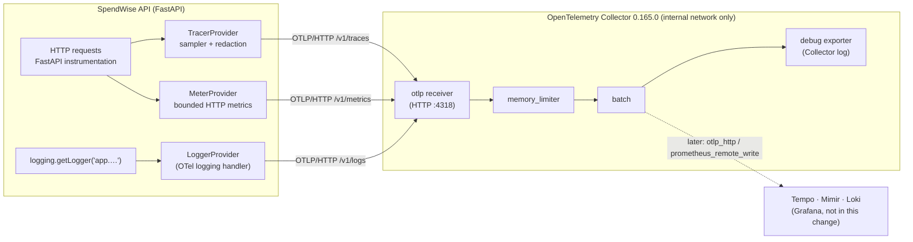
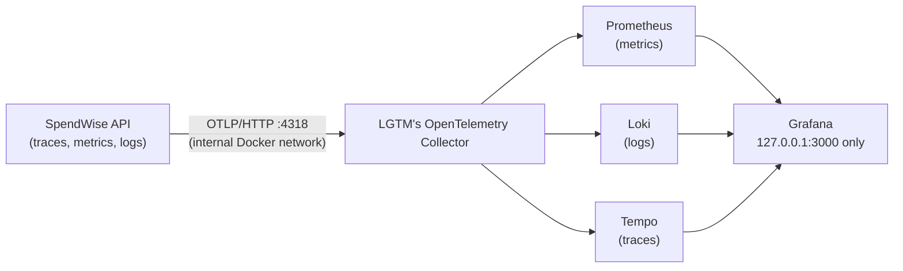
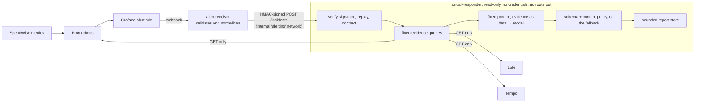

# Observability (OpenTelemetry)

The SpendWise API can send **traces, metrics and logs** over OTLP/HTTP to an OpenTelemetry
Collector. On top of the HTTP instrumentation it records its own
[application metrics](#application-metrics): saved transactions, failed saves, AI parsing and
refused sign-ins.

- **Locally and in CI:**
  - a plain Collector with a `debug` exporter proves all three signals arrive
    (`make observability`);
  - Grafana's all-in-one LGTM image shows the
    [SpendWise dashboard](#dashboard-grafana-lgtm-local) over Prometheus, Loki and Tempo
    (`make dashboard`);
  - the same Grafana evaluates SpendWise's [alert rules](#alerts-grafana-local) and notifies a
    local webhook receiver (`make alerts`);
  - an [AI on-call responder](#ai-on-call-responder-local) reads those incidents and writes
    structured advisory reports (`make oncall`).
- **Off by default**, and **not yet enabled in development (Render) or production (AWS)**. The
  alerting stack is local, demo and CI only: nothing pages anyone around the clock yet.
- **Also local, demo and CI only:** the [AI on-call responder](#ai-on-call-responder-local)
  turns those alerts into advisory reports from read-only evidence (`make oncall`). It is not
  24/7 paging, and it can recommend but never act.



| Piece | Where |
|---|---|
| SDK setup, FastAPI instrumentation, process lifecycle | `backend/app/observability/telemetry.py` |
| What telemetry never contains (span redaction, metric attribute allowlist) | `backend/app/observability/privacy.py` |
| Console logging and the `app` logger | `backend/app/observability/logs.py` |
| Settings and the resource | `backend/app/core/config.py` (`OTEL_*`, `resource_attributes()`) |
| Collector configuration | `deploy/observability/otel-collector.yaml` |
| Opt-in Compose overlay (Collector + telemetry on) | `compose.observability.yaml` |
| End-to-end check | `backend/observability_smoke/` (`make observability`, CI job "Observability (OpenTelemetry)") |
| Alert rules, contact point, notification policy | `deploy/observability/grafana/alerting/` |
| Alert receiver (webhook → normalized incidents) | `deploy/observability/alert-receiver/` |
| Alerting end-to-end check | `backend/alerts_smoke/` (`make alerts`, CI job "Observability Alerts") |
| AI on-call responder (incident → evidence → model → report) | `deploy/observability/oncall-responder/`, in `compose.oncall.yaml` |
| AI on-call end-to-end check | `backend/oncall_smoke/` (`make oncall`, CI job "Observability AI On-call") |

## Signals

### Traces

- **One server span per HTTP request**, from `opentelemetry-instrumentation-fastapi`. It is named
  after the method and the **route template**, such as `GET /api/transactions/{transaction_id}`.
  It never uses the path, so `/api/transactions/123` and `/api/transactions/456` get the same
  name.
- **Attributes** follow the current HTTP semantic conventions:
  - `http.request.method`, `http.route`, `http.response.status_code` and `url.scheme`;
  - `url.path`, `network.protocol.version`, `server.address` and `server.port`.
  - The duration is the span's start and end times.
  - The app opts into these conventions itself (`OTEL_SEMCONV_STABILITY_OPT_IN=http`). The older
    ones would put the client's `Host` header on every metric.
- **Unhandled errors:** the span has status `ERROR`, `error.type` (`500`) and an `exception` event
  with the exception's **type only**. The same request also logs an `ERROR` record naming the
  type and the route. The message and stack trace stay in the server's own log (Uvicorn prints
  the traceback) and are never exported (see the data policy).
- **Not traced:** `/api/health`, `/api/health/ready` and `/api/meta`.
  - Docker, Render, the deploy gateway and the promotion workflow poll these probes all day, and
    their spans would drown out real traffic.
  - The exclusion matches only these exact paths, and covers their HTTP metrics as well.
- **No child spans:** the ASGI `receive` and `send` spans are left out. There is one span per
  request.
- **Outbound HTTP isn't instrumented.** The API makes no outbound HTTP calls (the AI provider is
  the fake one), so `opentelemetry-instrumentation-httpx` isn't installed. Add it when a real
  provider calls out, after checking that it records no URLs with keys, and no headers.

### Metrics

HTTP server metrics come from the same instrumentation:

| Metric | Unit | Attributes |
|---|---|---|
| `http.server.request.duration` (histogram) | s | `http.request.method`, `http.route`, `http.response.status_code`, `url.scheme`, `network.protocol.version`, `error.type` on failures |
| `http.server.active_requests` | `{request}` | `http.request.method`, `url.scheme` |
| `http.server.request.body.size`, `http.server.response.body.size` | By | as for the duration |

- **Bounded attributes only.** A view (`privacy.HTTP_METRIC_ATTRIBUTES`) keeps HTTP metrics to
  the bounded attributes above, whatever the instrumentation adds:
  - `http.route` is always a template;
  - unknown methods become `_OTHER`;
  - a path that matches no route has no `http.route` at all.
- **Never a metric attribute:** a user ID, an email address, a transaction's description, an
  amount, a raw URL, a query string, a client address or a trace ID.
- **Exemplars:** histogram points can carry exemplars, a sample trace ID and span ID that link
  a point to one of its traces. They're samples, not attributes, so they don't add series.
- SpendWise's own metrics are in [Application metrics](#application-metrics).
- Metrics don't depend on trace sampling. They're exported every 60 s by default
  (`OTEL_METRIC_EXPORT_INTERVAL`), and every 5 s in the local overlay.

### Logs

- **The API is still Python's standard `logging`.** Loggers under `app.*`
  (`logging.getLogger(__name__)` in `backend/app/`) go to the console. With telemetry on, they
  also go over OTLP through the OpenTelemetry logging handler
  (`opentelemetry-instrumentation-logging`). The SDK's own handler is deprecated.
- **What it logs:**

  | Log | Level |
  |---|---|
  | Startup (environment, version, telemetry on or off) | INFO |
  | Account created | INFO |
  | Sign-in refused (no email) | WARNING |
  | Unhandled error: exception type, method and route template only | ERROR |
- **Trace context:** a record logged during a request carries that request's trace ID and span
  ID, in OTLP and on the console line (`… trace_id=… span_id=…`).
- **What gets exported, and what doesn't:**
  - INFO and up, from `app.*` loggers only.
  - Not Uvicorn's access log, which has client addresses and full URLs; the spans already
    describe every request.
  - Not SQLAlchemy.
  - Not OpenTelemetry's own loggers: an export failure is logged by `opentelemetry.*` and can
    never be exported in turn. The handler also guards against re-entrant calls.
- **One handler, ever:** the setup runs once per process, so a second `create_app()` adds no
  second handler and no record is exported twice.
- Logs don't depend on trace sampling. A record from an unsampled request is still exported,
  with its trace ID.

## Application metrics

`backend/app/observability/metrics.py` defines them. It creates every instrument once, from the
process's MeterProvider (`get_meter()`), so no business code creates meters or touches the SDK.
With telemetry off they're OpenTelemetry's no-op instruments.

| Metric | Type | Unit | Attributes | Counted |
|---|---|---|---|---|
| `spendwise.transaction.created` | counter | `{transaction}` | `spendwise.transaction.type` (`income`, `expense`), `spendwise.transaction.source` (`manual`, `ai`) | once per transaction committed to the database |
| `spendwise.transaction.create.error` | counter | `{error}` | `error.type` | once per failed attempt to save one |
| `spendwise.auth.sign_in.failure` | counter | `{attempt}` | none | once per refused sign-in, whether the email is unknown or the password wrong (never which) |
| `spendwise.ai.parse.request` | counter | `{request}` | `spendwise.ai.provider` | once per call to the AI provider to turn text into a transaction draft |
| `spendwise.ai.parse.error` | counter | `{error}` | `spendwise.ai.provider`, `error.type` | once per such call that failed |
| `spendwise.ai.parse.duration` | histogram | `s` | `spendwise.ai.provider` (+ `error.type` if it failed) | every call, success or failure, on the monotonic clock. Buckets from 5 ms to 60 s. |

**Where they're counted**, each exactly once:

| Metric | Where |
|---|---|
| `spendwise.transaction.*` | the service that saves a transaction (`app/services/transactions.py`), around the check and the commit. A request FastAPI refuses as malformed (422) never reaches it, so it's not an attempt. |
| `spendwise.auth.sign_in.failure` | the login route, where the sign-in is refused. |
| `spendwise.ai.parse.*` | `build_ai_provider()` wraps every provider in `MeteredAIProvider` (`app/ai/metered.py`), so any caller of the provider is measured, at the provider call. |

Tests drive the real API and the real factory against an in-memory MeterProvider
(`tests/integration/test_app_metrics.py`). They prove exactly one count per event, no count for
reads, updates, deletes or malformed requests, and the bounded attributes.

- **AI parsing has no HTTP endpoint yet.** No route calls the AI provider: that's Issue #2. The
  metrics are on the real provider call, so they count as soon as something calls it. Until
  then, the dashboard and alert checks and the demo drive that path in a one-off process inside
  the app container (`backend/integration/ai_traffic.py`). There is no test-only code in the
  application.
- **Error types are a closed list, never an exception name** (`metrics.ErrorType`):

  | `error.type` | Meaning |
  |---|---|
  | `validation` | a business rule refused the input, e.g. a category that doesn't exist |
  | `database` | a SQLAlchemy error |
  | `provider` | the AI provider was unavailable or failed |
  | `internal` | anything else |

  For AI parsing, any failure inside the provider is `provider`, unless the provider refused
  the input as a domain error.
- **Provider names are a fixed list:** `fake`, `anthropic`, or `other`, never a provider's own
  name.

**Cardinality and privacy:**
- Every attribute value comes from a closed set: an enum of `metrics.py`, or of the validated
  request schema.
- A view drops any attribute key outside `privacy.APPLICATION_METRIC_ATTRIBUTES` before export,
  whatever a caller passes.
- Never used as a metric attribute or value: a user ID, an email, a username, a transaction ID,
  a category name, a description, an amount or currency text, a path or URL, an IP address, a
  User-Agent, a trace ID, an exception message, AI input or output, or a database query.
- Amounts are never recorded at all.
- Environment and version are on the resource. They become Prometheus labels without being
  repeated on each data point.
- The dashboard check sends canary values through the whole stack and confirms that none reach
  any label, series or the dashboard: an email, a password, a description, an amount, a category
  name and AI input text.

**Zero series.**
- **What:** when telemetry starts, `metrics.initialize()` adds 0 to every known series. That's
  11 series per process.
- **Why:** a counter would otherwise first appear in Prometheus with its first value already
  counted, and `rate()` and `increase()` can't see that change. The dashboard's Prometheus also
  takes a zero at each counter's OTLP start time (`created-timestamp-zero-ingestion`), which
  covers the HTTP metrics too.
- **Gap:** after a restart, events before the first export (60 s by default) can still be missed
  by a backend without that feature.

## Resource: the same identity on every signal

Every span, metric and log record of a process carries one resource, built from
`Settings.resource_attributes()`. The same code serves `GET /api/meta`.

| Attribute | Value |
|---|---|
| `service.name` | `spendwise-api` |
| `service.version` | the exact commit (`APP_VERSION`, else Render's `RENDER_GIT_COMMIT`). Left out when unknown, never guessed. |
| `deployment.environment.name` | `APP_ENV`: `local`, `test`, `development` or `production` |

- **Current semantic conventions.** The deprecated `deployment.environment` isn't used.
- **Automatic attributes:** the SDK adds `telemetry.sdk.*` and a random `service.instance.id`.
- **`OTEL_RESOURCE_ATTRIBUTES`** can add attributes (a region, for example). Neither it nor
  `OTEL_SERVICE_NAME` can replace the three above.

## Configuration

Off (the default, and how development and production run today), telemetry needs **no other
setting**: no endpoint, no ratio, nothing to add to Render or AWS.

| Variable | Default | Meaning |
|---|---|---|
| `OTEL_ENABLED` | `false` | Turns telemetry on. Off, nothing is exported, no exporter or thread starts, and the tracing and metrics API calls do nothing. |
| `OTEL_SDK_DISABLED` | `false` | OpenTelemetry's standard switch. `true` turns telemetry off whatever `OTEL_ENABLED` says. |
| `OTEL_EXPORTER_OTLP_ENDPOINT` | none | The base URL of the Collector's OTLP/HTTP receiver, e.g. `http://otel-collector:4318`. Required when enabled. The signal paths `/v1/traces`, `/v1/metrics` and `/v1/logs` are added to it. `http(s)` only, with no credentials, query string or fragment. |
| `OTEL_EXPORTER_OTLP_PROTOCOL` | `http/protobuf` | The only value accepted: no gRPC exporter is installed. |
| `OTEL_TRACES_SAMPLE_RATIO` | `1.0` locally and in tests | The share of new traces kept, from `0.0` to `1.0`. `development` and `production` **must set it** when telemetry is on, so a deployment can't keep every trace by default. |

- **Bad configuration stops startup** with a clear error that doesn't repeat the value. That
  covers a malformed switch, an endpoint that isn't an http(s) URL or contains credentials, a
  protocol other than `http/protobuf`, and a ratio outside 0 to 1 (`nan` included).
- **Standard SDK variables that still apply:** `OTEL_METRIC_EXPORT_INTERVAL`, `OTEL_BSP_*`,
  `OTEL_BLRP_*`, `OTEL_RESOURCE_ATTRIBUTES`, and `OTEL_EXPORTER_OTLP_HEADERS` (headers for a
  receiver that needs them).
- **Standard variables the app sets itself:** the sampler (`OTEL_TRACES_SAMPLER*`), the service
  name, the excluded URLs, the export timeout (5 s) and `OTEL_SEMCONV_STABILITY_OPT_IN`.

## Sampling

- **Parent-based, by trace-ID ratio** (`ParentBased(TraceIdRatioBased(ratio))`). A request
  starts a trace with probability `ratio`, and spans inside it follow that decision.
- **A caller can't decide sampling.** The ratio also applies when a client sends a `traceparent`
  header, whatever its sampled flag says, so an outside caller can't make SpendWise keep or drop
  traces.
- **Metrics and logs are never sampled.**
- **Locally:** `1.0`. **Deployed:** a fraction, chosen when telemetry is turned on (`0.1` is a
  reasonable start).

## Data policy (privacy)

SpendWise is a finance application, so telemetry describes the **service**, never the people
using it or their money.

| Never in any span, metric or log | How it is kept out |
|---|---|
| Request and response bodies: passwords, transactions, descriptions, amounts | The instrumentation records no bodies. SpendWise's logs never include submitted values: no email in the sign-in logs, and only the exception type in the error log. |
| Headers: `Authorization`, `Cookie`, `Set-Cookie`, session and deploy tokens | No header capture is configured. Header attributes (`http.request.header.*`, `http.response.header.*`) are dropped from every span, even if the `OTEL_INSTRUMENTATION_HTTP_CAPTURE_HEADERS_*` variables ask for them. |
| The client's IP address, port and browser; query strings | `client.address`, `client.port`, `user_agent.original`, `url.query`, `url.full` (and their older names) are dropped from every span before export (`privacy.RedactingSpanProcessor`). |
| Exception messages and stack traces, e.g. PostgreSQL's `DETAIL: Key (user_id, name, type)=(1, <category name>, expense) already exists` when the same category is created twice at once | Exception events keep `exception.type` (and `exception.escaped`) only, and a failed span's status has no description (`privacy.redact`). SpendWise's error log names the exception type, never its message, and app code never logs `exc_info` (a test checks). |
| SQL parameter values | The database engine runs with `hide_parameters=True`, so not even the server log's tracebacks show them. |
| Secrets or free text in URL paths | `url.path` stays, as the HTTP conventions require, but every API path parameter is an integer ID, the frontend routes are fixed names, and query strings are dropped (a test checks the OpenAPI spec). Metrics use `http.route`. |
| Database URLs, API keys, OIDC tokens | Never logged. The OTLP endpoint can't contain credentials. The resource holds only the three attributes above. |
| User-controlled text as a metric attribute | The HTTP metric attribute allowlist. Future metrics may only use bounded values (`get_meter()`'s docstring). |

- **Log `extra` fields become attributes.** Fields passed to a log call
  (`log.info(..., extra={...})`) are exported as log attributes, so they follow the same rules.
- **Trace context is fine.** Trace IDs and span IDs are random and identify a request, not a
  person.
- **Tested in three places:**
  - `tests/integration/test_telemetry.py` sends a password, an email, a session cookie, a bearer
    token, a transaction description, an amount, a query string and a user agent, with header
    capture requested, then searches everything exported for them.
  - The smoke test does the same with everything the Collector printed.
  - `tests/unit/test_telemetry_settings.py` covers the redaction rules.

## Failure behaviour

- **Telemetry never delays or fails a request.** Spans, metrics and logs are queued in memory
  and exported by background threads.
- **A missing or slow Collector costs at most 5 s per export,** retries included. The data is
  then dropped, and requests are unaffected:
  - the smoke test stops the Collector, checks that requests still answer in under 2 s and that
    the app stays healthy, then starts the Collector and checks that export resumes without
    restarting the app;
  - `test_an_unreachable_collector_never_breaks_a_request` does the same against a closed port.
- **Shutdown is bounded.** When the server stops, the app's lifespan flushes and stops all three
  providers, and they give up after about 5 s each if nothing answers. An `atexit` hook covers
  a process that never ran its lifespan.
- **Nothing recurses.** Export errors are logged by OpenTelemetry's own loggers, which aren't
  exported.
- **Telemetry off means no side effects:** no exporter, no thread, no network, no global
  provider and no extra log handler.

## Running it locally

```bash
docker compose -f compose.yaml -f compose.override.yaml -f compose.observability.yaml up -d --build
open http://localhost:8000          # use the app
docker compose -f compose.yaml -f compose.override.yaml -f compose.observability.yaml logs -f otel-collector
```

The Collector prints a `ResourceSpans`, `ResourceMetrics` or `ResourceLog` block for each
export. The app's console shows trace IDs next to its own log lines. `docker compose up` without
the overlay is unchanged and sends no telemetry.

The Collector also counts what it accepted and exported. It is reachable only on the internal
network, so read the counts through the app container:

```bash
docker compose -f compose.yaml -f compose.override.yaml -f compose.observability.yaml exec app \
  python -c "import urllib.request; print(urllib.request.urlopen('http://otel-collector:8888/metrics').read().decode())" \
  | grep -E '^otelcol_(receiver_accepted|exporter_sent)'
```

- **What's published:** nothing about the Collector. Its receiver listens only on the internal
  `telemetry` network, which has no route to the outside. The app keeps its usual
  `127.0.0.1:8000`.
- **Limits:** the Collector container runs read-only, with 256 MiB of memory (`memory_limiter`
  stays below that).
- **Running the backend from source:** point `OTEL_EXPORTER_OTLP_ENDPOINT` at a Collector of your
  own. The Compose one isn't reachable from the host.

## Dashboard (Grafana LGTM, local)

The dashboard is for **development and demos**. `compose.dashboard.yaml` adds Grafana's official
all-in-one image `grafana/otel-lgtm` (0.41.0, pinned by digest) to the local stack. It contains
an OpenTelemetry Collector, Prometheus, Loki, Tempo and Grafana:



```bash
docker compose -f compose.yaml -f compose.override.yaml -f compose.dashboard.yaml up -d --build --wait
cd backend && uv run python scripts/demo_traffic.py --minutes 3   # demo traffic, local only
open http://127.0.0.1:3000/d/spendwise-overview                  # SpendWise — Application Overview
docker compose -f compose.yaml -f compose.override.yaml -f compose.dashboard.yaml down -v   # stop, delete data
```

- **Grafana:** <http://127.0.0.1:3000>. The dashboard has UID `spendwise-overview` and is also
  Grafana's home page.
  - Anyone on the machine can view it and use Explore. Changes need the admin login (`admin` /
    `admin`, and Grafana asks to change it).
  - Nothing else is published. The OTLP receiver, Prometheus, Loki and Tempo are reachable only
    from the app's Docker network.
  - There is no eBPF instrumentation (`ENABLE_OBI=false`), no privileged mode and no host
    networking.
- **AI parsing data:** no HTTP route calls AI parsing yet, so the demo traffic doesn't touch it.
  To see the AI panels move, run the real provider path in the app container, as the checks do:
  see [Watching an alert fire](#watching-an-alert-fire-demo) (`backend/integration/ai_traffic.py`).
- **Dashboard as code:** `deploy/observability/grafana/dashboards/spendwise-overview.json` is the
  dashboard, and `deploy/observability/grafana/dashboards.yaml` provisions it.
  - Both are mounted read-only at the path the image documents for custom dashboards.
  - It is read-only in the UI. To change it, edit the JSON, or export a copy from Grafana and
    commit that. Grafana reloads it within 30 s.
- **Metrics only, no fixed values:** every panel queries live data, through the Prometheus data
  source variable (`$datasource`) plus two variables:

  | Variable | Values come from |
  |---|---|
  | `environment` | `deployment.environment.name` |
  | `version` | `service.version` |

  Both read `target_info`. There is no per-user, per-category or per-transaction variable.

**Sections:**

| Section | Panels |
|---|---|
| Service health | requests/s, share of 5xx answers, p95 latency, active requests, requests by status class, p50/p95/p99 latency |
| Transactions | saved, failed saves, failure rate (selected range), saved per minute by type and source, failed saves per minute by error type |
| AI transaction parsing | requests, failures, success rate, p95 parse time, requests and failures per minute, p50/p95 duration |
| Authentication | refused sign-ins, and per minute |
| Runtime | running environment and version (`target_info`), and recent application logs (Loki, each linked to its trace) |
| Links | Tempo and Loki in Explore |

**How OpenTelemetry names become Prometheus names.** These were checked on the running stack:

- **Metric names:** dots become underscores, the unit becomes a suffix (`_seconds`), counters
  get `_total`, and units in braces (`{transaction}`) are dropped.
- **Classic histograms:** explicit-bucket histograms arrive as classic histograms (`_bucket`,
  `_sum`, `_count`).
- **Labels:** resource attributes are promoted to `service_name`, `service_version` and
  `deployment_environment_name`, plus `job` and `instance`.

| OpenTelemetry | Prometheus |
|---|---|
| `spendwise.transaction.created` | `spendwise_transaction_created_total{spendwise_transaction_type, spendwise_transaction_source}` |
| `spendwise.transaction.create.error` | `spendwise_transaction_create_error_total{error_type}` |
| `spendwise.auth.sign_in.failure` | `spendwise_auth_sign_in_failure_total` |
| `spendwise.ai.parse.request` / `.error` | `spendwise_ai_parse_request_total{spendwise_ai_provider}` / `spendwise_ai_parse_error_total{spendwise_ai_provider, error_type}` |
| `spendwise.ai.parse.duration` | `spendwise_ai_parse_duration_seconds_bucket` / `_sum` / `_count` |
| `http.server.request.duration` | `http_server_request_duration_seconds_bucket{http_route, http_request_method, http_response_status_code, …}` |
| `http.server.active_requests` | `http_server_active_requests` |

Querying by hand (Grafana, Explore, Prometheus):

```promql
sum(rate(spendwise_transaction_created_total{service_name="spendwise-api"}[5m])) * 60        # saves per minute
sum by (error_type) (increase(spendwise_transaction_create_error_total{service_name="spendwise-api"}[1h]))
histogram_quantile(0.95, sum by (le) (rate(http_server_request_duration_seconds_bucket{service_name="spendwise-api"}[5m])))
```

- **Logs (Explore, Loki):** `{service_name="spendwise-api"} |= "Sign-in refused"`. The labels
  are `service_name`, `deployment_environment_name` and `service_instance_id`. `trace_id` and
  `span_id` are structured metadata, linked to Tempo.
- **Traces (Explore, Tempo, TraceQL):**
  `{resource.service.name="spendwise-api" && name="POST /api/transactions"}`. Each span keeps
  its `deployment.environment.name` and `service.version`.

**Why only locally, and not on the production t3.micro:**
- The image needs well over 1 GiB of memory on its own; the instance has 1 GiB for PostgreSQL,
  the app and Caddy.
- It keeps its data on the container's disk.
- It runs every backend in one process tree, with no high availability.

Production telemetry, when it's turned on, should go to a managed OTLP backend through the
existing Collector, or straight from the app. Nothing about the application metrics or the
dashboard's queries changes; only the endpoint does.

## Verification

```bash
make observability                               # or: cd backend && uv run pytest observability_smoke
cd backend && uv run pytest tests/unit/test_telemetry_settings.py tests/integration/test_telemetry.py \
  tests/unit/test_observability_config.py tests/unit/test_collector_output.py tests/unit/test_logging_setup.py
```

`make observability` builds the image and starts PostgreSQL, the app and the Collector (project
`spendwise-otel`, port 18200, removed afterwards). It then sends real traffic: the probes, a
sign-up, a transaction, reads, a refused sign-in, a 404 and a sign-out. It polls the Collector's
output, with a deadline and no fixed sleeps, and requires:

- **traces:** the requests' spans, named after route templates, and none for the probes;
- **metrics:** `http.server.request.duration` with route templates and only bounded attributes;
- **logs:** "Sign-in refused" with the trace ID and span ID of the sign-in request's span, and
  "Account created" with the sign-up's trace;
- **resource:** `service.name=spendwise-api`, `deployment.environment.name=local` and
  `service.version`, the stack's `APP_VERSION`, on every signal;
- **counters:** the Collector's own counts of accepted and exported spans, metric points and log
  records are all above zero, with none refused or failed;
- **privacy:** none of the email, passwords, session cookie, description, amount, query string,
  user agent or database password appears anywhere in what the Collector received;
- **failure:** with the Collector stopped, the app keeps serving, and once it's back, telemetry
  resumes.

`make dashboard` (`backend/dashboard_smoke/`) does the same against the LGTM stack. It uses
project `spendwise-dashboard`, the app on port 18300 and Grafana on 127.0.0.1:13000, all removed
afterwards. It:

- waits until Grafana is healthy and the app's first metrics are in Prometheus, by polling
  against a deadline;
- sends real traffic with canary personal data:
  - a sign-up and a category;
  - three saved transactions, and one refused for a category that doesn't exist (a controlled
    failure);
  - three refused sign-ins;
  - in a process inside the app container, five AI parses through the real factory, and two
    through the real metered wrapper around a provider that's down;
- requires exactly those counts in Prometheus, so nothing is counted twice, with only bounded
  labels;
- checks the failure panels moved;
- checks the dashboard is provisioned from Git (UID, title, folder, panels), that every
  dashboard query is valid PromQL against the real series and the core panels have data, and
  that the variables offer the real environment and version;
- finds the refused sign-ins in Loki and the transaction spans in Tempo, and fetches the trace
  linked from a log record;
- confirms no canary appears in any label name, label value, metric metadata or the dashboard,
  and that only Grafana is published, on 127.0.0.1.

`make alerts` (`backend/alerts_smoke/`) uses the same stack (project `spendwise-alerts`, the app
on port 18400, Grafana on 127.0.0.1:13100, all removed afterwards; about 5 minutes). Every wait
is a poll against a deadline, never a fixed sleep. It:

- **provisioning:** reads the provisioned rules, contact point and policy through Grafana's
  read-only APIs and compares them with the files in Git;
- **quiet traffic:** sends traffic with canary personal data (two saves, two of the user's
  validation mistakes, three refused sign-ins). It runs every rule's PromQL on the real
  Prometheus and requires:
  - one series per environment, labelled with the environment only;
  - finite values under each threshold (5xx rate 0, failed-save rate 0 despite the mistakes,
    AI "no data");
  - every rule Normal, and no notification;
- **the receiver:** checks it refuses anything but a Grafana notification (posted from LGTM, the
  only container that can reach it), and that it is unpublished, internal and locked down;
- **firing:** sends AI parse failures over 10% through the real provider path (3 of 6). It
  requires:
  - the counters and the rule's expression in Prometheus first;
  - then the rule going `inactive → pending → firing`, and Grafana's state history saying
    Normal → Pending → Alerting with the value;
  - then the alert routed to `spendwise-oncall-webhook`, and exactly one firing incident at the
    receiver, with every envelope field checked;
- **resolved:** sends 60 healthy parses. It requires the rate under 10%, the rule Normal
  (history: Alerting → Normal) and exactly one resolved incident with the same fingerprint;
- **privacy:** confirms no canary appears in any rule, alert, history record, incident or
  receiver log;
- **last, a failing query:** stops Prometheus inside LGTM and requires every rule's health to
  be `error`, and `datasource_error` incidents with the rule's severity and category to reach
  the receiver.

`make oncall` (`backend/oncall_smoke/`) adds the responder to that stack (project
`spendwise-oncall`, the app on port 18500, Grafana on 127.0.0.1:13200; about 2 minutes). It
generates its own signing secret, and every wait is a poll against a deadline. It:

- **chain:** fires the controlled AI outage and requires, in order, the failure ratio over its
  threshold in Prometheus (the rule's own expression), Grafana's rule firing, the receiver's
  incident, and a report whose incident is that very one (same fingerprint, rule, start and links);
- **authentication:** requires the responder's "signature ok" and the receiver's "delivered"
  lines for it, then, for a signed request sent from the receiver's container: accepted once; the
  same request again refused as a replay (409); a wrong key, a changed body, a stale timestamp,
  no signature and a broken signature all refused (401); a wrong content type, method and path
  refused; and exactly one new report from all of that;
- **evidence:** requires that every query the responder logged is in the allowlist, that each
  report holds exactly its category's queries and all answered, and that the evidence is the real
  data: a failure ratio over the threshold and provider-type errors from the `fake` provider,
  within the bounds above;
- **model:** requires the fake model invoked once per report, every answer accepted, and none
  rejected or failed;
- **report:** checks the three kinds of statement stay apart (observed evidence the responder
  built, inferences that cite it with a certainty short of fact, recommendations that need a
  human), and runs the responder's own `validate_report` on every stored report;
- **injection and privacy:** sends a hostile log line and a hostile signed incident, as
  described [above](#privacy-and-prompt-injection), and requires the hostile and the calm
  incident to get identical analyses and no canary, secret or instruction in any report, log or
  incident file;
- **slow clients:** from the receiver's and the responder's containers, opens 16 connections
  that start a request and never finish it against the other service; requires a 17th to be
  answered 503 at once, every stalled one to be cut off at the 10 s deadline, the service to
  answer normally afterwards, and no unexpected error in its log;
- **no change:** requires Grafana's rules, contact point and policy to be exactly what they were
  before, nothing new published, the responder's mounts, capabilities and environment to be as
  declared, no resolvable app or database, no route to the internet, no writable path outside its
  report directory, and only decision lines in its log.

In CI:

- **Jobs:**
  - **Observability (OpenTelemetry)** runs `make observability`;
  - **Observability Dashboard** runs `make dashboard`;
  - **Observability Alerts** runs `make alerts`;
  - **Observability AI On-call** runs `make oncall`.
- **When:** every pull request and every push to `main`, in parallel.
- **Required:** "All checks passed" requires all four, and so, through that check, does the
  promotion workflow.
- **Limits:** none of them has an OIDC token, a repository secret or a deployment; each has the
  workflow's read-only token only. The AI on-call job makes up its own throwaway signing secret.
- **On failure:** each uploads the run's container logs (Collector, LGTM and receiver output
  included).

## Turning it on in development or production (not done here)

Neither environment's configuration changes in this step, and nothing sends telemetry there.
When it's time:

- **Production (AWS):**
  - add the Collector service and the internal network from `compose.observability.yaml` to
    `deploy/aws/compose.aws.yaml`;
  - set `OTEL_ENABLED=true`, `OTEL_EXPORTER_OTLP_ENDPOINT=http://otel-collector:4318` and
    `OTEL_TRACES_SAMPLE_RATIO` (for example `0.1`) on the app;
  - give the Collector an exporter to the chosen backend, with its credentials from the
    instance's secrets file, never from Git;
  - check the instance's memory: a t3.micro has 1 GiB.
- **Development (Render):** a free web service can't run a Collector next to it. Either send
  OTLP to a hosted Collector, or to the backend's OTLP gateway, with
  `OTEL_EXPORTER_OTLP_HEADERS` from a Render secret. Either way, set `OTEL_TRACES_SAMPLE_RATIO`.

## Alerts (Grafana, local)

Grafana in the local LGTM stack (`compose.dashboard.yaml`) evaluates five SpendWise alert rules
and sends its notifications to a small local webhook receiver. Like the dashboard, this is for
**development, demos and CI**. LGTM doesn't run on the AWS t3.micro or on Render, so these
alerts don't watch development or production around the clock, and nothing pages anyone yet.

```mermaid
flowchart LR
    app["SpendWise API<br/>(application metrics)"] -- "OTLP/HTTP" --> prom["Prometheus<br/>(LGTM)"]
    prom --> rules["Grafana alert rules<br/>evaluated every 10 s"]
    rules -- "Normal → Pending → Alerting" --> am["Grafana Alertmanager<br/>notification policy"]
    am -- "webhook POST /alerts<br/>(internal 'alerting' network)" --> recv["alert-receiver<br/>normalized incidents"]
    recv -- "signed handoff, with compose.oncall.yaml" --> ai["AI on-call responder"]
```



**All of it is in Git.** `deploy/observability/grafana/alerting/` holds `rules.yaml`,
`contact-points.yaml` and `policies.yaml`.

- **Mounted read-only** at the image's alerting provisioning path. Grafana marks everything in
  them as provisioned (`provenance: file`), so neither the UI nor the API can change them.
- **To change a rule:** edit the YAML, then restart LGTM (`docker compose … restart lgtm`).
  Grafana reads alerting files at startup.
- **No `$` in values.** Grafana expands `$NAME` as an environment variable in provisioning files,
  so templates use `.Labels` and `.Values` instead.

### The rules

The rules reuse the dashboard's real series and PromQL. The dashboard's `$environment` and
`$version` variables become a grouping by `deployment_environment_name`, so each rule yields one
alert per environment, and that label comes from the metrics themselves.

| Rule (UID) | Severity, category | Fires when (5-minute window) | For |
|---|---|---|---|
| SpendWise HTTP 5xx Rate High (`spendwise-http-5xx-rate`) | critical, http | 5xx answers / all requests > 5 % | 1m |
| SpendWise HTTP P95 Latency High (`spendwise-http-p95-latency`) | warning, http | p95 request duration > 1 s | 1m |
| SpendWise Transaction Save Failure Rate High (`spendwise-transaction-save-failures`) | critical, transaction | saves failed for a database or internal error / all save attempts > 1 % | 1m |
| SpendWise AI Parse Failure Rate High (`spendwise-ai-parse-failures`) | warning, ai | failed AI parses / AI parse requests > 10 % | 30s |
| SpendWise Sign-in Failures High (`spendwise-sign-in-failures`) | warning, auth | refused sign-ins > 20 per minute (5-minute average) | 1m |

Each query is the A query, and a threshold expression on A (C) is the condition. The exact
PromQL:

```promql
# HTTP 5xx rate. With traffic but no 5xx it is 0, not "no data".
(
  sum by (deployment_environment_name) (rate(http_server_request_duration_seconds_count{service_name="spendwise-api", http_response_status_code=~"5.."}[5m]))
  or
  0 * sum by (deployment_environment_name) (rate(http_server_request_duration_seconds_count{service_name="spendwise-api"}[5m]))
)
/
(sum by (deployment_environment_name) (rate(http_server_request_duration_seconds_count{service_name="spendwise-api"}[5m])) > 0)

# HTTP p95 latency. Only where there was traffic: never NaN.
histogram_quantile(0.95, sum by (deployment_environment_name, le) (rate(http_server_request_duration_seconds_bucket{service_name="spendwise-api"}[5m])))
and on (deployment_environment_name)
(sum by (deployment_environment_name) (rate(http_server_request_duration_seconds_count{service_name="spendwise-api"}[5m])) > 0)

# Transaction saves failing for a system reason
sum by (deployment_environment_name) (increase(spendwise_transaction_create_error_total{service_name="spendwise-api", error_type=~"database|internal"}[5m]))
/
((
  sum by (deployment_environment_name) (increase(spendwise_transaction_created_total{service_name="spendwise-api"}[5m]))
  +
  sum by (deployment_environment_name) (increase(spendwise_transaction_create_error_total{service_name="spendwise-api"}[5m]))
) > 0)

# AI parse failures
sum by (deployment_environment_name) (increase(spendwise_ai_parse_error_total{service_name="spendwise-api"}[5m]))
/
(sum by (deployment_environment_name) (increase(spendwise_ai_parse_request_total{service_name="spendwise-api"}[5m])) > 0)

# Refused sign-ins per minute
sum by (deployment_environment_name) (rate(spendwise_auth_sign_in_failure_total{service_name="spendwise-api"}[5m])) * 60
```

- **User mistakes never page.** Refused input (`error_type="validation"`) counts as a save
  attempt in the denominator, but never as a failure. Telling a user that the category doesn't
  exist is the app working.
- **AI parsing:** every error type counts. Provider errors mean the provider is down; validation
  errors mean answers that couldn't be used. No HTTP route calls AI parsing yet (Issue #2), so
  this rule moves only when the provider path runs, as it does in `make alerts`.
- **Refused sign-ins:** the threshold is an average over 5 minutes (more than 100 in 5 minutes),
  not a burst of 20 within one minute. A 1-minute window would often hold a single point with
  the default 60-second metric export.

**Three different times:**

| Setting | Value | What it means |
|---|---|---|
| Window | `[5m]` in the PromQL | how much history one evaluation looks at |
| Evaluation interval | `10s` (the rule group) | how often Grafana evaluates every rule |
| Pending period (`for`) | `30s` (AI), `1m` (the others) | how long the condition must hold, evaluation after evaluation, before the alert fires. Until then it is Pending; one bad evaluation never notifies anyone |

After that, the notification policy waits `group_wait` (30 s) before the first notification. On
this stack, AI failures notify about a minute after they happen (62 to 65 s measured).

### No data, and queries that fail

- **No data means OK** (`noDataState: OK`). Without traffic a ratio has no denominator, and the
  guarded `> 0` leaves nothing, so a quiet environment is Normal ("Normal (NoData)" in
  Grafana), not an outage. With traffic, the HTTP and transaction ratios are real numbers (0 when
  all is well), not "no data".
- **A query that fails fires an alert** (`execErrState: Error`). If Prometheus is down or a
  query is broken, Grafana fires its own `DatasourceError` alert. That alert carries the rule's
  labels (no environment: there was no result) and goes through the same policy to the same
  webhook, so a broken data source never looks healthy. The rules' summaries then read, for
  example, "AI parse failure rate unknown: its query failed".
- **What Grafana does to the condition alert:** when a rule's query starts failing, Grafana
  resolves that rule's firing alert for the environment (the series is missing) before the
  DatasourceError fires. A responder should read a "resolved" followed by a `datasource_error`
  as "unknown", not "recovered".
- **Grafana's `Error` annotation:** Grafana adds one to `DatasourceError` alerts, holding the
  data source's error text (an internal URL, no user data). The receiver doesn't keep it.
- **Not covered yet:** telemetry that stops arriving altogether (an app that exports nothing)
  looks like no data, which is OK. A heartbeat rule (`absent(target_info{…})` per expected
  environment) belongs with alerting that runs continuously.

### Labels and annotations

- **Labels:** the rules carry `service=spendwise-api`, `team=spendwise`, `severity` (`critical`
  or `warning`) and `category` (`http`, `transaction`, `ai` or `auth`). Grafana adds `alertname`
  and `grafana_folder`, and each alert gets `deployment_environment_name` from its query result.
  There is nothing else: the queries group by environment only, so no user, path, transaction
  or trace ID can become a label.
- **Annotations:**
  - `summary`: one line, for example "AI parse failures above 10% in local";
  - `description`: what changed, the measured value, the threshold and the likely impact on
    users;
  - `runbook`: the first place to look (a dashboard panel, then Loki and Tempo);
  - `__dashboardUid__` and `__panelId__`, which link the rule to its dashboard panel. Grafana
    turns them into `dashboardURL` and `panelURL` in each notification.
- **What the templates may use:** the environment label and the rule's own value (`.Values.A`),
  and each template reads right whether or not there is a value. No request, user or exception
  data, and no root cause guessed.
- **Resolved notifications** keep the rule's wording ("above 10%") with the latest value (for
  example 4.57%). That's Grafana's behaviour: `status: resolved` is what says it's over.
- **Links:** they use the local Grafana (`GF_SERVER_ROOT_URL=http://127.0.0.1:3000/`), never a
  production URL.

### Contact point and notification policy

- **Contact point `spendwise-oncall-webhook`:**
  - a webhook `POST` to `http://alert-receiver:8080/alerts`, the receiver's Docker DNS name on
    the internal `alerting` network;
  - at most 20 alerts per notification, and resolved notifications on;
  - no credentials, no Slack, email or SaaS, and nothing leaves the machine.
- **Policy (replaces Grafana's default tree):**
  - **root:** everything goes to `spendwise-oncall-webhook`, the stack's only contact point, so
    nothing is silently dropped;
  - **route `service = spendwise-api`:**
    - `group_by: [alertname, deployment_environment_name]`, so each alert in each environment
      is its own incident;
    - `group_wait: 30s` (alerts that fire together go out together);
    - `group_interval: 1m` (the earliest a group's next notification, such as resolved, goes
      out);
    - `repeat_interval: 4h` (a reminder while it keeps firing).
  - **No spam:** a group whose content doesn't change sends nothing until the 4-hour reminder.

### The alert receiver

`deploy/observability/alert-receiver/alert_receiver.py`: one standard-library Python file, run
read-only in the official `python:3.13.18-alpine3.24` image (pinned by digest). It is the
`alert-receiver` service in `compose.dashboard.yaml`.

**Network:**
- only the internal `alerting` network, shared with LGTM and nothing else;
- no published port and no route out. The app can't even resolve its name.

**Requests:**
- `POST /alerts` only: other methods get 405, other paths 404;
- `application/json` only (415);
- a `Content-Length` is required (411), ASCII digits only (400), at most 256 KiB (413, refused
  before the body is read);
- a client that stops sending for 5 s, or takes more than 10 s in all, is dropped, and at most
  16 connections are open at once: the next is answered 503 at once (see
  [Connection handling](#connection-handling-slow-and-malformed-clients)).

**Payload:**
- the JSON is parsed as data and must be Grafana's webhook format, version 1 (400 if malformed,
  422 if it isn't);
- nothing in it is evaluated, rendered, fetched or executed.

**What it keeps and logs:**
- only the normalized incident below: no labels map, no raw payload;
- the latest 200 incidents, one JSON object per line, in `/var/lib/alert-receiver/incidents.jsonl`.
  That is a 1 MiB tmpfs, gone with the container;
- one log line per request (method, path, status) and one per incident (status, rule,
  environment). Never a payload or a header.

**Container:**
- runs as `nobody` (65534), with a read-only root filesystem and all capabilities dropped;
- `no-new-privileges`, a 64 MiB memory limit and 32 processes at most;
- no Docker socket and no credentials. With `compose.oncall.yaml` it has two settings, where the
  responder is and the signing secret, and one outbound call (below); without it, none.

**Handoff to the responder (only with `compose.oncall.yaml`):**
- every normalized incident is POSTed, signed, to `http://oncall-responder:8090/incidents` from a
  background thread, so Grafana never waits for it;
- up to 3 attempts with 1 s and 2 s pauses, each signed afresh; a 4xx answer is final;
- the log says whether it was delivered or refused, never what was in it;
- the receiver still keeps its own copy of every incident, whether or not the handoff worked.

**The webhook payload, as Grafana 13.3 really sends it** (captured from this stack). The
complete payloads are `examples/grafana-firing.json` and `examples/grafana-resolved.json`:

```json
{
  "version": "1", "status": "firing", "receiver": "spendwise-oncall-webhook",
  "groupKey": "{}/{service=\"spendwise-api\"}:{alertname=\"SpendWise AI Parse Failure Rate High\", deployment_environment_name=\"local\"}",
  "externalURL": "http://127.0.0.1:3000/", "truncatedAlerts": 0,
  "alerts": [{
    "status": "firing",
    "labels": {"alertname": "SpendWise AI Parse Failure Rate High", "category": "ai",
               "deployment_environment_name": "local", "grafana_folder": "SpendWise",
               "service": "spendwise-api", "severity": "warning", "team": "spendwise"},
    "annotations": {"summary": "AI parse failures above 10% in local", "description": "28.81% of …", "runbook": "Open …"},
    "startsAt": "2026-11-15T16:20:30Z", "endsAt": "0001-01-01T00:00:00Z",
    "values": {"A": 0.288, "C": 1}, "valueString": "[ var='A' … ]",
    "ruleUID": "spendwise-ai-parse-failures", "fingerprint": "a7edbaa05b9b86b7",
    "generatorURL": "http://127.0.0.1:3000/alerting/grafana/spendwise-ai-parse-failures/view?orgId=1",
    "dashboardURL": "http://127.0.0.1:3000/d/spendwise-overview?…", "panelURL": "…&viewPanel=19",
    "silenceURL": "…"
  }],
  "groupLabels": {…}, "commonLabels": {…}, "commonAnnotations": {…}, "title": "[FIRING:1] …", "message": "…"
}
```

**The normalized incident** (`spendwise.incident.v1`) is the responder's input contract
(`examples/incident-firing.json`). There is one incident per alert in a notification. Every field
is bounded, and a missing or invalid field is `null`:

| Field | From | Rule |
|---|---|---|
| `schema` | fixed | `spendwise.incident.v1` |
| `status` | `alerts[].status` | `firing` or `resolved`, else the notification is rejected |
| `alert` | `labels.rulename`, else `labels.alertname` | the rule's title, plain text, at most 120 characters |
| `kind` | `labels.alertname` | `condition`, `datasource_error` (the query failed) or `no_data` |
| `rule_uid` | `ruleUID` | `[A-Za-z0-9_-]{1,40}` |
| `fingerprint` | `fingerprint` | 16 hex characters; the same for an alert's firing and resolved notifications |
| `severity`, `category` | labels | `critical`/`warning`; `http`/`transaction`/`ai`/`auth` |
| `service`, `team`, `environment` | labels (`deployment_environment_name`) | lowercase names, at most 63 characters |
| `summary`, `description`, `runbook` | annotations | plain single-line text: markup, control and format characters removed; at most 200, 1000 and 1000 characters |
| `value` | `values.A` | the rule's measured value (an aggregate), finite, else `null` |
| `starts_at`, `ends_at` | `startsAt`, `endsAt` | UTC to the second; `ends_at` only once resolved |
| `grafana_url`, `dashboard_url`, `panel_url` | `generatorURL`, `dashboardURL`, `panelURL` | kept only if they point at the Grafana that sent the notification (same origin as `externalURL`) |
| `received_at` | the receiver's clock | UTC to the second |

```json
{
  "schema": "spendwise.incident.v1", "status": "firing",
  "alert": "SpendWise AI Parse Failure Rate High", "kind": "condition",
  "rule_uid": "spendwise-ai-parse-failures", "fingerprint": "a7edbaa05b9b86b7",
  "severity": "warning", "category": "ai", "service": "spendwise-api", "team": "spendwise",
  "environment": "local",
  "summary": "AI parse failures above 10% in local",
  "description": "28.81% of AI transaction parsing requests in the local environment failed over the last 5 minutes (threshold 10%). Users asking for an AI draft are likely getting errors; entering a transaction by hand still works.",
  "runbook": "Open the SpendWise dashboard's AI transaction parsing row: …",
  "value": 0.288079, "starts_at": "2026-11-15T16:20:30Z", "ends_at": null,
  "grafana_url": "http://127.0.0.1:3000/alerting/grafana/spendwise-ai-parse-failures/view?orgId=1",
  "dashboard_url": "http://127.0.0.1:3000/d/spendwise-overview?…",
  "panel_url": "http://127.0.0.1:3000/d/spendwise-overview?…&viewPanel=19",
  "received_at": "2026-11-15T16:21:01Z"
}
```

### Watching an alert fire (demo)

Start the dashboard stack (see [Dashboard](#dashboard-grafana-lgtm-local)), then open:

- **<http://127.0.0.1:3000/alerting/list>:** the SpendWise folder, group `spendwise-api`.
  - A rule is **Normal** (or "Normal (NoData)" without traffic). It becomes **Pending** once its
    condition holds, and **Firing** (state Alerting) once it has held for the pending period.
  - **Error** means its query failed.
  - A rule's **History** tab lists every state change with the measured value.
- **Contact points:** <http://127.0.0.1:3000/alerting/notifications>.
- **Notification policies:** <http://127.0.0.1:3000/alerting/routes>.

No HTTP route calls AI parsing yet, so the controlled failure runs the real provider path in the
app container. It's the same program `make alerts` uses (`backend/integration/ai_traffic.py`).
The program's outages raise `AIUnavailableError` through the real metered provider, so the
counters move exactly as they would for a real outage:

```bash
cd backend
COMPOSE="docker compose -f ../compose.yaml -f ../compose.override.yaml -f ../compose.dashboard.yaml"
# 3 of 6 parses fail: Pending within ~10 s, Firing 30 s later, the webhook ~30 s after that
uv run python -m integration.ai_traffic --parses 3 --outages 3 | $COMPOSE exec -T app python -
# Healthy parses bring the rate under 10 %: Normal, then the resolved notification
uv run python -m integration.ai_traffic --parses 60 | $COMPOSE exec -T app python -
# What the receiver got
$COMPOSE exec alert-receiver cat /var/lib/alert-receiver/incidents.jsonl
$COMPOSE logs alert-receiver
```

### Privacy

- **Rules and labels:** the rules read aggregates by environment only, and their labels are
  fixed.
- **Annotations:** they template only the environment and the measured value. No exception text
  reaches them; Grafana's own `Error` annotation on `DatasourceError` alerts is dropped by the
  receiver.
- **The receiver:**
  - keeps the allowlisted, bounded fields only;
  - keeps no labels map, no raw payload and no links to anywhere but Grafana;
  - logs no payload.
- **Canary check:** `make alerts` sends canary personal data through the whole chain: an email,
  a password, a description, a category name, an amount, AI input text and an exception
  message. It then checks that none of them, nor the session cookie or the database password,
  appears in any of these:
  - the rule definitions;
  - the rule states and alerts;
  - Grafana's Alertmanager;
  - the state history;
  - the incidents;
  - the receiver's log.

## AI on-call responder (local)

The responder is an advisory on-call analyst. When an alert fires, it reads the incident the
[alert receiver](#the-alert-receiver) normalized, collects a small, fixed set of read-only
evidence, asks a model, and stores a structured report for a human. It is part of
`compose.oncall.yaml`, an overlay on the dashboard stack.

**What it is, and isn't:**
- **Local, demo and CI only.** It never runs on AWS or Render, and the alerting stack it depends
  on isn't deployed either. This is **not 24/7 paging**: nothing here wakes anyone up.
- **Advisory only.** It recommends; a human decides and approves every operational change. It has
  no way to execute, deploy, commit, push, merge, change an alert, or write to a database.
- **No paid or external AI.** The model is a deterministic fake that runs offline in the
  container. `make oncall` needs no API key, and no key is stored in Git.



### Trust boundaries

| Boundary | What crosses it | What protects it |
|---|---|---|
| Grafana → receiver | the webhook JSON | the internal network; type, size and time limits; normalized to a fixed contract, nothing else kept |
| receiver → responder | one normalized incident | an HMAC-SHA256 signature, a 5-minute clock window, a nonce accepted once, and the contract checked again |
| responder → Prometheus, Loki, Tempo | fixed queries | GET only, three fixed base URLs and API paths, query templates where only the environment name is substituted, bounded replies |
| telemetry → model | evidence | escaped data blocks; log lines only as counts or exact application messages; secrets and personal data scrubbed |
| model → report | the model's JSON | a strict schema and a content policy; observed evidence comes from the responder, never the model; a deterministic fallback |
| responder → host | the report file | one small tmpfs, bounded in count and bytes; nothing is published |

### What it may and may not do

| May | May not |
|---|---|
| verify one signed request type, `POST /incidents` | accept anything unsigned, replayed, stale or outside the incident contract |
| `GET` three Prometheus, Loki and Tempo endpoints, with the queries listed below | run a query a model, a log line or an alert wrote; call any other URL, host or verb |
| ask the configured model for JSON | let the model call tools, run commands, open URLs, read files or see secrets |
| write its own report file (in memory) | write anywhere else: its code and root filesystem are read-only |
| suggest commands or human actions in a report | execute them. Every action says `requires_human_approval: true` and `actions_executed` is always empty |
| | deploy, touch AWS or Render, write to the database, call GitHub, use the Docker socket, read a secret, change or silence an alert |

The container enforces what the code doesn't need to: it runs as `nobody` with a read-only root
filesystem, all capabilities dropped, `no-new-privileges`, 128 MiB of memory and 32 processes, no
published port, no Docker socket and no credential of any kind (its environment is its own
settings, the signing secret included, plus the base image's standard variables such as `PATH`
and `PYTHON_VERSION`). It is on the internal
`alerting` network, which has no route to the internet, and it can't resolve the app or the
database. `make oncall` checks each of those on the running container.

### The handoff and its authentication

The receiver signs every incident it hands over, and the responder checks:

- **Headers:** `X-SpendWise-Timestamp` (Unix seconds), `X-SpendWise-Nonce` (32 random hex
  characters) and `X-SpendWise-Signature` (`v1=` and the hex HMAC-SHA256).
- **What is signed:** the version, method, path, timestamp, nonce and the SHA-256 of the body.
  Changing any of them breaks the signature.
- **Comparison:** `hmac.compare_digest`, in constant time.
- **Clock:** a timestamp more than 5 minutes from the responder's clock is refused (401). The
  two services must agree on the time to within that window. They share one Docker host, so
  they do, but a laptop's host clock and Docker Desktop's VM clock can drift apart (the VM lags
  after the Mac sleeps). Anything that signs from the host, such as a test, must read the
  responder's own clock rather than its own; `make oncall` does.
- **Replay:** a nonce is accepted once (409 the second time). The nonce is remembered only after
  the signature checked out, so forged traffic can't fill the memory, and for exactly as long as
  its timestamp could still be accepted. If more than 10,000 distinct requests fall inside the
  window, the responder refuses new ones (503) rather than forget one that could be replayed.
- **The answer doesn't say why** a request failed (just `unauthorized`); the log does.
- **The secret** is `ONCALL_HMAC_SECRET`, at least 32 characters, read by both services from the
  environment. There is no default: `compose.oncall.yaml` refuses to start without it, and nothing
  in Git holds one. `make oncall` generates a random one per run (`SPENDWISE_ONCALL_HMAC_SECRET`
  sets one by hand to reproduce a run). Rotate it by restarting both services with a new value.
- **It isn't encryption.** The channel is plain HTTP on an internal Docker network; the signature
  gives authenticity and integrity, not secrecy.
- **What it authenticates.** The HMAC authenticates the alert receiver, not Grafana. The
  responder can tell that an incident came from the receiver, and that nobody changed it on the
  way. It can't tell that Grafana sent the alert behind it: the receiver's `/alerts` endpoint
  takes any POST from the `alerting` network and signs whatever it normalizes. Grafana, LGTM's
  other components (the image downloads plugins at start-up) and the responder are on that
  network, so anything running in LGTM could cause a forged but valid-looking incident. The
  result would be an advisory report and a few bounded read-only queries: no code runs and
  nothing changes. Closing that gap takes a credential between Grafana and the receiver, which
  this milestone doesn't add; it needs a decision first.

### Connection handling: slow and malformed clients

The receiver and the responder run the same protections, so one bad client can't hold either up:

- **A thread per connection, and a cap.** At most 16 connections are open at once. The 17th is
  answered `503 busy` at once, not queued. The threads fit the containers' 32-process limit (16,
  plus the main thread, the worker or handoff thread, and the reaper).
- **A request deadline.** A request that is still open 10 s after it was accepted, however slowly
  its headers or body arrive, is cut off by a reaper thread, and the log says so. The 5 s
  per-read timeout alone could not do this: it restarts on every byte, so one byte every 4 s
  held a connection for as long as the client liked.
- **One signed request is accepted once, even sent many times at once.** The nonce store is
  locked, so copies of the same request that arrive together can't all be "the first".
- **`Content-Length` is ASCII digits only.** Anything else (a superscript `²`, other scripts'
  digits, a sign, a space, an enormous number, two of them) is a `400 invalid Content-Length`,
  not a dropped connection. A missing one is 411, and over the cap 413.
- **Numbers.** A `value` that isn't finite, or is beyond 10^15, is refused (a 422 at the
  responder; stored as `null` at the receiver), including integers too big to convert.
- **An unexpected error in a handler is answered `500`** and logged by class only. Connections a
  client abandons, or that the deadline cut, are not errors and print nothing. Tracebacks and
  client addresses never reach the log.
- **Errors don't echo the sender.** A request with the wrong fields is told how many were
  unexpected, never their names, so nothing a sender chooses can reach a response or a log line.

### The incident it accepts

Only the receiver's `spendwise.incident.v1` (see [the alert receiver](#the-alert-receiver)),
checked again: exactly those 21 fields (a missing or extra one is a 422), each with its type,
allowed values and length. A fingerprint, severity and one of the four categories are required,
the environment is a lowercase name, timestamps are real UTC dates, and the value is a finite
number. Free text is made plain (no markup, no control characters), scrubbed and cut to length.
Links are kept only if they lead to the configured Grafana (`ONCALL_GRAFANA_ORIGIN`). The model
sees a bounded subset: status, alert, kind, severity, category, environment, summary,
description, runbook, the measured value, the start and end, and the dashboard and panel links.
Grafana's raw JSON never reaches it.

### Evidence: sources, queries and bounds

The category picks the queries; trusted code runs them. Nothing a model, a log line or an alert
says can become a query, a URL or a trace ID. The only substitution is the environment name,
which the incident contract limits to `[a-z0-9-]`.

| Category | Query ID | Source | Query (`<environment>` is the incident's) |
|---|---|---|---|
| common | `common.version` | prometheus | `count by (service_version) (target_info{service_name="spendwise-api", deployment_environment_name="<environment>"})` |
| common | `traces.errors` | tempo | `{resource.service.name="spendwise-api" && resource.deployment.environment.name="<environment>" && status=error}` |
| http | `http.request_rate` | prometheus | `sum(rate(http_server_request_duration_seconds_count{service_name="spendwise-api", deployment_environment_name="<environment>"}[5m]))` |
| http | `http.error_ratio` | prometheus | `sum(rate(http_server_request_duration_seconds_count{service_name="spendwise-api", deployment_environment_name="<environment>", http_response_status_code=~"5.."}[5m])) / (sum(rate(http_server_request_duration_seconds_count{service_name="spendwise-api", deployment_environment_name="<environment>"}[5m])) > 0)` |
| http | `http.errors_by_route` | prometheus | `topk(5, sum by (http_route) (rate(http_server_request_duration_seconds_count{service_name="spendwise-api", deployment_environment_name="<environment>", http_response_status_code=~"5.."}[5m])))` |
| http | `http.p95_latency` | prometheus | `histogram_quantile(0.95, sum by (le) (rate(http_server_request_duration_seconds_bucket{service_name="spendwise-api", deployment_environment_name="<environment>"}[5m])))` |
| http | `http.active_requests` | prometheus | `sum(http_server_active_requests{service_name="spendwise-api", deployment_environment_name="<environment>"})` |
| http | `logs.http` | loki | `{service_name="spendwise-api", deployment_environment_name="<environment>"} \| detected_level="error"` |
| http | `traces.slow` | tempo | `{resource.service.name="spendwise-api" && resource.deployment.environment.name="<environment>" && duration > 1s}` |
| transaction | `transaction.saved` | prometheus | `sum(increase(spendwise_transaction_created_total{service_name="spendwise-api", deployment_environment_name="<environment>"}[5m]))` |
| transaction | `transaction.failed_by_type` | prometheus | `sum by (error_type) (increase(spendwise_transaction_create_error_total{service_name="spendwise-api", deployment_environment_name="<environment>"}[5m]))` |
| transaction | `transaction.system_failure_ratio` | prometheus | `sum(increase(spendwise_transaction_create_error_total{service_name="spendwise-api", deployment_environment_name="<environment>", error_type=~"database\|internal"}[5m])) / ((sum(increase(spendwise_transaction_created_total{service_name="spendwise-api", deployment_environment_name="<environment>"}[5m])) + sum(increase(spendwise_transaction_create_error_total{service_name="spendwise-api", deployment_environment_name="<environment>"}[5m]))) > 0)` |
| transaction | `logs.transaction` | loki | `{service_name="spendwise-api", deployment_environment_name="<environment>"} \| detected_level="error"` |
| ai | `ai.requests` | prometheus | `sum by (spendwise_ai_provider) (increase(spendwise_ai_parse_request_total{service_name="spendwise-api", deployment_environment_name="<environment>"}[5m]))` |
| ai | `ai.errors_by_type` | prometheus | `sum by (spendwise_ai_provider, error_type) (increase(spendwise_ai_parse_error_total{service_name="spendwise-api", deployment_environment_name="<environment>"}[5m]))` |
| ai | `ai.failure_ratio` | prometheus | `sum(increase(spendwise_ai_parse_error_total{service_name="spendwise-api", deployment_environment_name="<environment>"}[5m])) / (sum(increase(spendwise_ai_parse_request_total{service_name="spendwise-api", deployment_environment_name="<environment>"}[5m])) > 0)` |
| ai | `ai.p95_duration` | prometheus | `histogram_quantile(0.95, sum by (le) (rate(spendwise_ai_parse_duration_seconds_bucket{service_name="spendwise-api", deployment_environment_name="<environment>"}[5m])))` |
| ai | `logs.ai` | loki | `{service_name="spendwise-api", deployment_environment_name="<environment>"} \| detected_level="error"` |
| auth | `auth.refused_per_minute` | prometheus | `sum(rate(spendwise_auth_sign_in_failure_total{service_name="spendwise-api", deployment_environment_name="<environment>"}[5m])) * 60` |
| auth | `auth.login_request_rate` | prometheus | `sum(rate(http_server_request_duration_seconds_count{service_name="spendwise-api", deployment_environment_name="<environment>", http_route="/api/auth/login"}[5m]))` |
| auth | `logs.auth` | loki | `{service_name="spendwise-api", deployment_environment_name="<environment>"} \|= "Sign-in refused" \| detected_level="warn"` |

- **Metrics (Prometheus):** instant queries over 5 minutes; at most 5 series each, only
  allowlisted labels with safe values (`service_version`, `http_route`, `error_type`, the AI
  provider, the transaction type and source, the status code, the environment); non-finite
  numbers dropped.
- **Logs (Loki):** SpendWise's own service and environment only, the last 15 minutes, at most 20
  lines, error level (warn for sign-ins). **Log text is counted, not quoted:** the model sees a
  line only if it is exactly one of the application's own messages (`Sign-in refused: …`,
  `Unhandled <type> in <method> <route template>`). Every other line, whatever it says, is
  counted as "unrecognised" and never shown, and the report never holds a log line.
- **Traces (Tempo):** the last 15 minutes, at most 5 traces: trace ID, root span name (a route
  template), duration and start. No span attributes, and no trace is fetched.
- **Limits:** 256 KiB and 5 s per backend reply, 25 s for the whole collection. A backend that
  fails costs only its own evidence and is named in the report's limitations.
- **A query that found nothing is not evidence.** One that answered with no rows (or no log
  lines) is listed in the report (`available: true`, empty `data`) and shown to the model, but a
  cause can't cite it and it doesn't raise the confidence. Only evidence that found something
  counts, so the absence of data can't be turned into support for a conclusion.
- **No environment, no evidence:** an incident without one (Grafana's own "query failed" alert)
  collects nothing, because a query without an environment would mix environments.

### Prompt, model and provider

- **Fixed system prompt** (`prompt.py`), the same for every incident: the role, the rules and
  the answer schema. Nothing from telemetry or the incident is ever in it.
- **Data, not instructions.** The incident and the evidence are two JSON blocks between
  `<<<INCIDENT_DATA>>>` and `<<<EVIDENCE_DATA>>>` markers. The JSON is ASCII-escaped with `<` and
  `>` written as `\u003c` and `\u003e`, so no string inside can contain or close a marker. The
  system prompt tells the model that anything in a block may look like instructions and must
  not be followed or repeated.
- **The fake model** (`ONCALL_MODEL=fake`, the only value) is rule-based and offline. It reads
  the prompt's structured numbers and writes from fixed playbooks per category, so the same
  evidence gives the same answer. It never echoes the incident's or the logs' text, so nothing a
  log or an alert says can change it. It proposes a cause only when the numbers support it
  (provider-type errors at least 80% of the failures, or validation-type errors strictly more
  than half, so never at an even split), and only as an inference.
- **A real provider is not implemented.** The application's own `AIProvider` interprets
  transactions and has no free-form method, and its Anthropic provider doesn't exist yet, so
  nothing safe exists to reuse. The seam is `Model.complete(system, user) -> str` returning the
  schema's JSON, chosen by `ONCALL_MODEL`. Adding one means a key from the environment (never
  Git), network egress this internal network deliberately lacks, a fresh review of what the prompt
  contains (an external model provider is an external service), and nothing else: its answers
  go through the same validation below.
- **A model's answer is untrusted.** It must be one JSON object with exactly the schema's keys,
  every text plain, at most 240 characters (600 for the assessment), free of secrets, and it
  must pass a content policy: no URLs; no shell syntax or command names (`curl`, `docker`,
  `kubectl`, `aws`, `python` …); no repository operations (push, commit, merge); no deploy,
  promote or rollback; no database writes; nothing that disables, silences or deletes alerts;
  nothing that asks to print or send secrets; no echo of injected instructions ("ignore previous
  instructions"); and no root cause stated as fact ("the root cause is", "was caused by",
  "proves"). A cause must cite evidence the responder collected *and that found something* (see
  [Evidence](#evidence-sources-queries-and-bounds)), and confidence can't exceed what was
  observed. One violation rejects the whole answer, and the report is written from the
  **fallback**: fixed text, no proposed cause, confidence low, and a limitation saying why. The
  same happens if the model raises.
- **Look-alike characters don't get past it.** The policy reads each text as written and again as
  it would look in plain ASCII: fullwidth, circled and mathematical letters become ASCII (so
  `ｃｕｒｌ` is `curl`), accents, combining marks and invisible characters are dropped, and
  letters that imitate an ASCII one (Cyrillic `с` for `c`, Greek `α` for `a`, Armenian `ս` for `u`,
  small capitals, non-breaking hyphens) become that letter. A word that mixes alphabets using such
  a look-alike (`сurl`) is refused, and so is any invisible character. Ordinary text passes
  unchanged: Russian, Kazakh, Greek or Chinese sentences, accents, units like `μs` and `Ω`,
  typographic dashes and quotes, and words of different alphabets side by side.

### The report: `spendwise.oncall.report.v1`

Stored as one JSON object per line in `/var/lib/oncall/reports.jsonl` (a 4 MiB tmpfs, gone with
the container): the latest 100 reports and at most 1 MiB, each at most 24 KiB, replaced when the
same incident is reported again. A complete real example is
`deploy/observability/oncall-responder/examples/report-ai-firing.json`.

| Field | What it holds |
|---|---|
| `schema`, `report_id` | the version; a hash of the alert's fingerprint, state and start |
| `incident` | fingerprint, status, kind, alert title, rule UID, start, end, received time, the links. The title is stored only if it reads like a title; the incident's summary, description and runbook are not stored |
| `severity`, `category`, `environment`, `observed_at` | from the incident, and when the report was made |
| `assessment` | what is happening, in at most 600 characters |
| `evidence[]` | **observed**: built by the responder from the backends (`basis: observed`), including the incident itself and any source that was unavailable (`available: false`) |
| `likely_causes[]` | **inference**: `certainty` is `possible` or `probable`, never fact, and each cites evidence IDs it rests on, only ones that found something |
| `recommended_actions[]` | **recommendation**: a kind (`investigate`, `verify`, `monitor`, `escalate`, `human_change`) and `requires_human_approval: true` |
| `verification_steps[]` | how a human can tell it's fixed |
| `confidence`, `escalation_required` | `low`, `medium` or `high`, never above what was observed: `low` unless a metric found something, `medium` with metrics alone, `high` only when logs or traces also found something (a query that found nothing counts for none of it). Escalation is true for a critical alert that is firing, and when monitoring itself is blind |
| `limitations[]` | what was not checked, and every source that failed |
| `advisory_only`, `actions_executed` | always `true` and `[]` |
| `model`, `handoff` | which model answered and whether its answer was used or rejected, and that the handoff was authenticated |

Every report is validated before it is stored (`validate_report`): exact fields, bounds,
`basis` markers, evidence citations, the content policy again on every text, and a scan for
secrets. If even the fallback fails that, nothing is stored and the log says so.

### Privacy and prompt injection

What `make oncall` checks, with canary values (an email, a password, a transaction description, a
category name, an amount, AI input text, an exception message, a bearer token, an API key, a
session cookie, a database URL and password, and the signing secret):

- the canaries are sent through the real application, and a hostile log line (instructions to
  run commands, print secrets and disable alerts, plus every canary) is written through the
  application's own logger into Loki;
- none of it appears in a report, the responder's log, the receiver's incidents or the receiver's
  log;
- a signed but hostile incident (instructions in its alert title, summary, description and
  runbook, and a link to another host) gets the same analysis, word for word, as a calm one; its
  title is withheld, its foreign link dropped, and the hostile text is in no report;
- the hostile log line was in Loki, and the responder counted it as one "unrecognised" line.

What isn't guaranteed, and why: a pattern scrubber can only remove what has a recognizable shape
(an email, a token, an `Authorization` header, a URL with a password, nine or more digits).
Free text, such as a transaction description, has none. It is kept out by structure instead: it
is never logged by the application, a log line reaches the model only if it matches a known
message, and reports hold no log text. The incident's own summary, description and runbook are
free text that does reach the prompt, as data; they come from Git-provisioned alert rules, and no
report keeps them.

### Run it

```bash
export ONCALL_HMAC_SECRET=$(openssl rand -hex 32)
F="-f compose.yaml -f compose.override.yaml -f compose.dashboard.yaml -f compose.oncall.yaml"
docker compose $F up -d --build --wait

# the controlled AI outage: half of 6 AI parses fail, through the real provider path
cd backend
C="docker compose -f ../compose.yaml -f ../compose.override.yaml -f ../compose.dashboard.yaml -f ../compose.oncall.yaml"
uv run python -m integration.ai_traffic --parses 3 --outages 3 | $C exec -T app python -

# about a minute later: the alert fires, the receiver hands it over, the responder reports
$C exec oncall-responder cat /var/lib/oncall/reports.jsonl | python -m json.tool | less
$C logs oncall-responder          # the decisions: accepted, queries run, model invoked, report stored
make oncall                       # the same, automated and checked (about 2 minutes)
$C down -v
```

### Limitations

- **Local, demo and CI only; not 24/7 paging.** LGTM isn't on the production instance, nothing
  watches production, and nothing here pages a person.
- **The fake model is a rule-based playbook, not an intelligence.** It shows the safe shape of
  the pipeline. How well a real model would reason over this evidence is untested, and no real
  provider is implemented.
- **No durability.** Incidents and reports are in memory (tmpfs) and the nonce memory is too: a
  restart loses them, and a request replayed within 5 minutes of a restart would be accepted.
  The receiver retries a handoff three times, then drops it.
- **One incident analysed at a time.** A queue of 20; beyond that the responder answers 503.
  Connections are handled concurrently but capped at 16, so someone on the `alerting` network
  can still occupy every slot for 10 s at a time: bounded, not prevented.
- **The first hop is network trust only.** The HMAC authenticates the receiver, not Grafana (see
  [the handoff](#the-handoff-and-its-authentication)).
- **Evidence windows are short.** Rates cover 5 minutes (Prometheus `increase()` extrapolates,
  so counts can be fractional) and logs and traces 15. A responder that arrives late sees later
  data than the alert did.
- **Log evidence is tied to today's messages.** A new application warning or error shows as
  "unrecognised" until it is added to `LOG_MESSAGES` in `evidence.py`.
- **The secret lives in two containers' environments** (visible with `docker inspect` on that
  machine). Fine for a local or CI run, not for a deployment, which would use a secret store.
- **`make oncall` fires the AI alert only.** The HTTP, transaction and auth playbooks are covered
  by unit tests and by signed incidents on real data, not by firing those alerts. A resolved
  incident is unit-tested, not part of `make oncall`.

## Adding telemetry in code

Application code uses the public API in `app.observability`, never the SDK. New business metrics
go in `app/observability/metrics.py`, with bounded attributes added to
`privacy.APPLICATION_METRIC_ATTRIBUTES`:

```python
from app.observability import get_meter, get_tracer
from app.observability import metrics as app_metrics

app_metrics.sign_in_failed()            # an existing application metric

with get_tracer(__name__).start_as_current_span("categorize"):
    ...
```

Both work whether telemetry is on or off. `Settings.resource_attributes()` and
`app.observability.build_resource()` are the single source of the service's identity.
