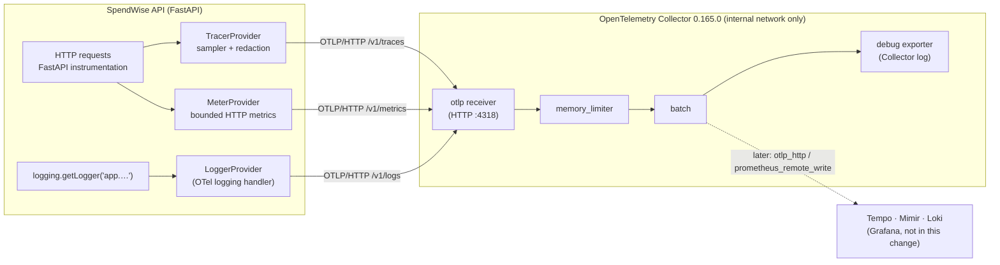
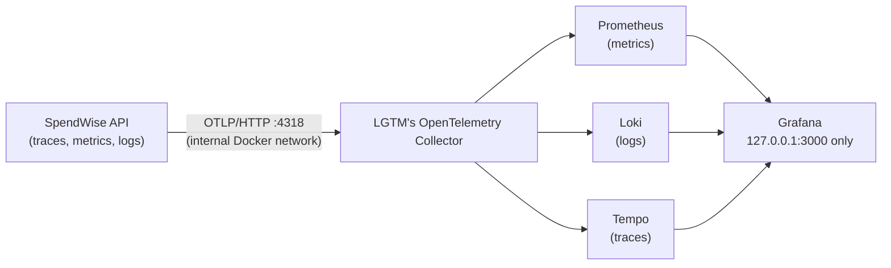

# Observability (OpenTelemetry)

The SpendWise API can send **traces, metrics and logs** over OTLP/HTTP to an OpenTelemetry
Collector. On top of the HTTP instrumentation it records its own
[application metrics](#application-metrics): saved transactions, failed saves, AI parsing and
refused sign-ins.

- **Locally and in CI:**
  - a plain Collector with a `debug` exporter proves all three signals arrive
    (`make observability`);
  - Grafana's all-in-one LGTM image shows the
    [SpendWise dashboard](#dashboard-grafana-lgtm-local) over Prometheus, Loki and Tempo
    (`make dashboard`).
- **Off by default**, and **not yet enabled in development (Render) or production (AWS)**.
- **Not done yet:** alerts and the AI on-call responder are the next steps.



| Piece | Where |
|---|---|
| SDK setup, FastAPI instrumentation, process lifecycle | `backend/app/observability/telemetry.py` |
| What telemetry never contains (span redaction, metric attribute allowlist) | `backend/app/observability/privacy.py` |
| Console logging and the `app` logger | `backend/app/observability/logs.py` |
| Settings and the resource | `backend/app/core/config.py` (`OTEL_*`, `resource_attributes()`) |
| Collector configuration | `deploy/observability/otel-collector.yaml` |
| Opt-in Compose overlay (Collector + telemetry on) | `compose.observability.yaml` |
| End-to-end check | `backend/observability_smoke/` (`make observability`, CI job "Observability (OpenTelemetry)") |

## Signals

### Traces

- **One server span per HTTP request**, from `opentelemetry-instrumentation-fastapi`. It is named
  after the method and the **route template**, such as `GET /api/transactions/{transaction_id}`.
  It never uses the path, so `/api/transactions/123` and `/api/transactions/456` get the same
  name.
- **Attributes** follow the current HTTP semantic conventions:
  - `http.request.method`, `http.route`, `http.response.status_code` and `url.scheme`;
  - `url.path`, `network.protocol.version`, `server.address` and `server.port`.
  - The duration is the span's start and end times.
  - The app opts into these conventions itself (`OTEL_SEMCONV_STABILITY_OPT_IN=http`). The older
    ones would put the client's `Host` header on every metric.
- **Unhandled errors:** the span has status `ERROR`, `error.type` (`500`) and an `exception` event
  with the exception's **type only**. The same request also logs an `ERROR` record naming the
  type and the route. The message and stack trace stay in the server's own log (Uvicorn prints
  the traceback) and are never exported (see the data policy).
- **Not traced:** `/api/health`, `/api/health/ready` and `/api/meta`.
  - Docker, Render, the deploy gateway and the promotion workflow poll these probes all day, and
    their spans would drown out real traffic.
  - The exclusion matches only these exact paths, and covers their HTTP metrics as well.
- **No child spans:** the ASGI `receive` and `send` spans are left out. There is one span per
  request.
- **Outbound HTTP isn't instrumented.** The API makes no outbound HTTP calls (the AI provider is
  the fake one), so `opentelemetry-instrumentation-httpx` isn't installed. Add it when a real
  provider calls out, after checking that it records no URLs with keys, and no headers.

### Metrics

HTTP server metrics come from the same instrumentation:

| Metric | Unit | Attributes |
|---|---|---|
| `http.server.request.duration` (histogram) | s | `http.request.method`, `http.route`, `http.response.status_code`, `url.scheme`, `network.protocol.version`, `error.type` on failures |
| `http.server.active_requests` | `{request}` | `http.request.method`, `url.scheme` |
| `http.server.request.body.size`, `http.server.response.body.size` | By | as for the duration |

- **Bounded attributes only.** A view (`privacy.HTTP_METRIC_ATTRIBUTES`) keeps HTTP metrics to
  the bounded attributes above, whatever the instrumentation adds:
  - `http.route` is always a template;
  - unknown methods become `_OTHER`;
  - a path that matches no route has no `http.route` at all.
- **Never a metric attribute:** a user ID, an email address, a transaction's description, an
  amount, a raw URL, a query string, a client address or a trace ID.
- **Exemplars:** histogram points can carry exemplars, a sample trace ID and span ID that link
  a point to one of its traces. They're samples, not attributes, so they don't add series.
- SpendWise's own metrics are in [Application metrics](#application-metrics).
- Metrics don't depend on trace sampling. They're exported every 60 s by default
  (`OTEL_METRIC_EXPORT_INTERVAL`), and every 5 s in the local overlay.

### Logs

- **The API is still Python's standard `logging`.** Loggers under `app.*`
  (`logging.getLogger(__name__)` in `backend/app/`) go to the console. With telemetry on, they
  also go over OTLP through the OpenTelemetry logging handler
  (`opentelemetry-instrumentation-logging`). The SDK's own handler is deprecated.
- **What it logs:**

  | Log | Level |
  |---|---|
  | Startup (environment, version, telemetry on or off) | INFO |
  | Account created | INFO |
  | Sign-in refused (no email) | WARNING |
  | Unhandled error: exception type, method and route template only | ERROR |
- **Trace context:** a record logged during a request carries that request's trace ID and span
  ID, in OTLP and on the console line (`… trace_id=… span_id=…`).
- **What gets exported, and what doesn't:**
  - INFO and up, from `app.*` loggers only.
  - Not Uvicorn's access log, which has client addresses and full URLs; the spans already
    describe every request.
  - Not SQLAlchemy.
  - Not OpenTelemetry's own loggers: an export failure is logged by `opentelemetry.*` and can
    never be exported in turn. The handler also guards against re-entrant calls.
- **One handler, ever:** the setup runs once per process, so a second `create_app()` adds no
  second handler and no record is exported twice.
- Logs don't depend on trace sampling. A record from an unsampled request is still exported,
  with its trace ID.

## Application metrics

`backend/app/observability/metrics.py` defines them. It creates every instrument once, from the
process's MeterProvider (`get_meter()`), so no business code creates meters or touches the SDK.
With telemetry off they're OpenTelemetry's no-op instruments.

| Metric | Type | Unit | Attributes | Counted |
|---|---|---|---|---|
| `spendwise.transaction.created` | counter | `{transaction}` | `spendwise.transaction.type` (`income`, `expense`), `spendwise.transaction.source` (`manual`, `ai`) | once per transaction committed to the database |
| `spendwise.transaction.create.error` | counter | `{error}` | `error.type` | once per failed attempt to save one |
| `spendwise.auth.sign_in.failure` | counter | `{attempt}` | none | once per refused sign-in, whether the email is unknown or the password wrong (never which) |
| `spendwise.ai.parse.request` | counter | `{request}` | `spendwise.ai.provider` | once per call to the AI provider to turn text into a transaction draft |
| `spendwise.ai.parse.error` | counter | `{error}` | `spendwise.ai.provider`, `error.type` | once per such call that failed |
| `spendwise.ai.parse.duration` | histogram | `s` | `spendwise.ai.provider` (+ `error.type` if it failed) | every call, success or failure, on the monotonic clock. Buckets from 5 ms to 60 s. |

**Where they're counted**, each exactly once:

| Metric | Where |
|---|---|
| `spendwise.transaction.*` | the service that saves a transaction (`app/services/transactions.py`), around the check and the commit. A request FastAPI refuses as malformed (422) never reaches it, so it's not an attempt. |
| `spendwise.auth.sign_in.failure` | the login route, where the sign-in is refused. |
| `spendwise.ai.parse.*` | `build_ai_provider()` wraps every provider in `MeteredAIProvider` (`app/ai/metered.py`), so any caller of the provider is measured, at the provider call. |

Tests drive the real API and the real factory against an in-memory MeterProvider
(`tests/integration/test_app_metrics.py`). They prove exactly one count per event, no count for
reads, updates, deletes or malformed requests, and the bounded attributes.

- **AI parsing has no HTTP endpoint yet.** No route calls the AI provider: that's Issue #2. The
  metrics are on the real provider call, so they count as soon as something calls it. Until
  then, the dashboard checks and the demo drive that path in a one-off process inside the app
  container (`backend/dashboard_smoke/test_dashboard.py`). There is no test-only code in the
  application.
- **Error types are a closed list, never an exception name** (`metrics.ErrorType`):

  | `error.type` | Meaning |
  |---|---|
  | `validation` | a business rule refused the input, e.g. a category that doesn't exist |
  | `database` | a SQLAlchemy error |
  | `provider` | the AI provider was unavailable or failed |
  | `internal` | anything else |

  For AI parsing, any failure inside the provider is `provider`, unless the provider refused
  the input as a domain error.
- **Provider names are a fixed list:** `fake`, `anthropic`, or `other`, never a provider's own
  name.

**Cardinality and privacy:**
- Every attribute value comes from a closed set: an enum of `metrics.py`, or of the validated
  request schema.
- A view drops any attribute key outside `privacy.APPLICATION_METRIC_ATTRIBUTES` before export,
  whatever a caller passes.
- Never used as a metric attribute or value: a user ID, an email, a username, a transaction ID,
  a category name, a description, an amount or currency text, a path or URL, an IP address, a
  User-Agent, a trace ID, an exception message, AI input or output, or a database query.
- Amounts are never recorded at all.
- Environment and version are on the resource. They become Prometheus labels without being
  repeated on each data point.
- The dashboard check sends canary values through the whole stack and confirms that none reach
  any label, series or the dashboard: an email, a password, a description, an amount, a category
  name and AI input text.

**Zero series.**
- **What:** when telemetry starts, `metrics.initialize()` adds 0 to every known series. That's
  11 series per process.
- **Why:** a counter would otherwise first appear in Prometheus with its first value already
  counted, and `rate()` and `increase()` can't see that change. The dashboard's Prometheus also
  takes a zero at each counter's OTLP start time (`created-timestamp-zero-ingestion`), which
  covers the HTTP metrics too.
- **Gap:** after a restart, events before the first export (60 s by default) can still be missed
  by a backend without that feature.

## Resource: the same identity on every signal

Every span, metric and log record of a process carries one resource, built from
`Settings.resource_attributes()`. The same code serves `GET /api/meta`.

| Attribute | Value |
|---|---|
| `service.name` | `spendwise-api` |
| `service.version` | the exact commit (`APP_VERSION`, else Render's `RENDER_GIT_COMMIT`). Left out when unknown, never guessed. |
| `deployment.environment.name` | `APP_ENV`: `local`, `test`, `development` or `production` |

- **Current semantic conventions.** The deprecated `deployment.environment` isn't used.
- **Automatic attributes:** the SDK adds `telemetry.sdk.*` and a random `service.instance.id`.
- **`OTEL_RESOURCE_ATTRIBUTES`** can add attributes (a region, for example). Neither it nor
  `OTEL_SERVICE_NAME` can replace the three above.

## Configuration

Off (the default, and how development and production run today), telemetry needs **no other
setting**: no endpoint, no ratio, nothing to add to Render or AWS.

| Variable | Default | Meaning |
|---|---|---|
| `OTEL_ENABLED` | `false` | Turns telemetry on. Off, nothing is exported, no exporter or thread starts, and the tracing and metrics API calls do nothing. |
| `OTEL_SDK_DISABLED` | `false` | OpenTelemetry's standard switch. `true` turns telemetry off whatever `OTEL_ENABLED` says. |
| `OTEL_EXPORTER_OTLP_ENDPOINT` | none | The base URL of the Collector's OTLP/HTTP receiver, e.g. `http://otel-collector:4318`. Required when enabled. The signal paths `/v1/traces`, `/v1/metrics` and `/v1/logs` are added to it. `http(s)` only, with no credentials, query string or fragment. |
| `OTEL_EXPORTER_OTLP_PROTOCOL` | `http/protobuf` | The only value accepted: no gRPC exporter is installed. |
| `OTEL_TRACES_SAMPLE_RATIO` | `1.0` locally and in tests | The share of new traces kept, from `0.0` to `1.0`. `development` and `production` **must set it** when telemetry is on, so a deployment can't keep every trace by default. |

- **Bad configuration stops startup** with a clear error that doesn't repeat the value. That
  covers a malformed switch, an endpoint that isn't an http(s) URL or contains credentials, a
  protocol other than `http/protobuf`, and a ratio outside 0 to 1 (`nan` included).
- **Standard SDK variables that still apply:** `OTEL_METRIC_EXPORT_INTERVAL`, `OTEL_BSP_*`,
  `OTEL_BLRP_*`, `OTEL_RESOURCE_ATTRIBUTES`, and `OTEL_EXPORTER_OTLP_HEADERS` (headers for a
  receiver that needs them).
- **Standard variables the app sets itself:** the sampler (`OTEL_TRACES_SAMPLER*`), the service
  name, the excluded URLs, the export timeout (5 s) and `OTEL_SEMCONV_STABILITY_OPT_IN`.

## Sampling

- **Parent-based, by trace-ID ratio** (`ParentBased(TraceIdRatioBased(ratio))`). A request
  starts a trace with probability `ratio`, and spans inside it follow that decision.
- **A caller can't decide sampling.** The ratio also applies when a client sends a `traceparent`
  header, whatever its sampled flag says, so an outside caller can't make SpendWise keep or drop
  traces.
- **Metrics and logs are never sampled.**
- **Locally:** `1.0`. **Deployed:** a fraction, chosen when telemetry is turned on (`0.1` is a
  reasonable start).

## Data policy (privacy)

SpendWise is a finance application, so telemetry describes the **service**, never the people
using it or their money.

| Never in any span, metric or log | How it is kept out |
|---|---|
| Request and response bodies: passwords, transactions, descriptions, amounts | The instrumentation records no bodies. SpendWise's logs never include submitted values: no email in the sign-in logs, and only the exception type in the error log. |
| Headers: `Authorization`, `Cookie`, `Set-Cookie`, session and deploy tokens | No header capture is configured. Header attributes (`http.request.header.*`, `http.response.header.*`) are dropped from every span, even if the `OTEL_INSTRUMENTATION_HTTP_CAPTURE_HEADERS_*` variables ask for them. |
| The client's IP address, port and browser; query strings | `client.address`, `client.port`, `user_agent.original`, `url.query`, `url.full` (and their older names) are dropped from every span before export (`privacy.RedactingSpanProcessor`). |
| Exception messages and stack traces, e.g. PostgreSQL's `DETAIL: Key (user_id, name, type)=(1, <category name>, expense) already exists` when the same category is created twice at once | Exception events keep `exception.type` (and `exception.escaped`) only, and a failed span's status has no description (`privacy.redact`). SpendWise's error log names the exception type, never its message, and app code never logs `exc_info` (a test checks). |
| SQL parameter values | The database engine runs with `hide_parameters=True`, so not even the server log's tracebacks show them. |
| Secrets or free text in URL paths | `url.path` stays, as the HTTP conventions require, but every API path parameter is an integer ID, the frontend routes are fixed names, and query strings are dropped (a test checks the OpenAPI spec). Metrics use `http.route`. |
| Database URLs, API keys, OIDC tokens | Never logged. The OTLP endpoint can't contain credentials. The resource holds only the three attributes above. |
| User-controlled text as a metric attribute | The HTTP metric attribute allowlist. Future metrics may only use bounded values (`get_meter()`'s docstring). |

- **Log `extra` fields become attributes.** Fields passed to a log call
  (`log.info(..., extra={...})`) are exported as log attributes, so they follow the same rules.
- **Trace context is fine.** Trace IDs and span IDs are random and identify a request, not a
  person.
- **Tested in three places:**
  - `tests/integration/test_telemetry.py` sends a password, an email, a session cookie, a bearer
    token, a transaction description, an amount, a query string and a user agent, with header
    capture requested, then searches everything exported for them.
  - The smoke test does the same with everything the Collector printed.
  - `tests/unit/test_telemetry_settings.py` covers the redaction rules.

## Failure behaviour

- **Telemetry never delays or fails a request.** Spans, metrics and logs are queued in memory
  and exported by background threads.
- **A missing or slow Collector costs at most 5 s per export,** retries included. The data is
  then dropped, and requests are unaffected:
  - the smoke test stops the Collector, checks that requests still answer in under 2 s and that
    the app stays healthy, then starts the Collector and checks that export resumes without
    restarting the app;
  - `test_an_unreachable_collector_never_breaks_a_request` does the same against a closed port.
- **Shutdown is bounded.** When the server stops, the app's lifespan flushes and stops all three
  providers, and they give up after about 5 s each if nothing answers. An `atexit` hook covers
  a process that never ran its lifespan.
- **Nothing recurses.** Export errors are logged by OpenTelemetry's own loggers, which aren't
  exported.
- **Telemetry off means no side effects:** no exporter, no thread, no network, no global
  provider and no extra log handler.

## Running it locally

```bash
docker compose -f compose.yaml -f compose.override.yaml -f compose.observability.yaml up -d --build
open http://localhost:8000          # use the app
docker compose -f compose.yaml -f compose.override.yaml -f compose.observability.yaml logs -f otel-collector
```

The Collector prints a `ResourceSpans`, `ResourceMetrics` or `ResourceLog` block for each
export. The app's console shows trace IDs next to its own log lines. `docker compose up` without
the overlay is unchanged and sends no telemetry.

The Collector also counts what it accepted and exported. It is reachable only on the internal
network, so read the counts through the app container:

```bash
docker compose -f compose.yaml -f compose.override.yaml -f compose.observability.yaml exec app \
  python -c "import urllib.request; print(urllib.request.urlopen('http://otel-collector:8888/metrics').read().decode())" \
  | grep -E '^otelcol_(receiver_accepted|exporter_sent)'
```

- **What's published:** nothing about the Collector. Its receiver listens only on the internal
  `telemetry` network, which has no route to the outside. The app keeps its usual
  `127.0.0.1:8000`.
- **Limits:** the Collector container runs read-only, with 256 MiB of memory (`memory_limiter`
  stays below that).
- **Running the backend from source:** point `OTEL_EXPORTER_OTLP_ENDPOINT` at a Collector of your
  own. The Compose one isn't reachable from the host.

## Dashboard (Grafana LGTM, local)

The dashboard is for **development and demos**. `compose.dashboard.yaml` adds Grafana's official
all-in-one image `grafana/otel-lgtm` (0.41.0, pinned by digest) to the local stack. It contains
an OpenTelemetry Collector, Prometheus, Loki, Tempo and Grafana:



```bash
docker compose -f compose.yaml -f compose.override.yaml -f compose.dashboard.yaml up -d --build --wait
cd backend && uv run python scripts/demo_traffic.py --minutes 3   # demo traffic, local only
open http://127.0.0.1:3000/d/spendwise-overview                  # SpendWise — Application Overview
docker compose -f compose.yaml -f compose.override.yaml -f compose.dashboard.yaml down -v   # stop, delete data
```

- **Grafana:** <http://127.0.0.1:3000>. The dashboard has UID `spendwise-overview` and is also
  Grafana's home page.
  - Anyone on the machine can view it and use Explore. Changes need the admin login (`admin` /
    `admin`, and Grafana asks to change it).
  - Nothing else is published. The OTLP receiver, Prometheus, Loki and Tempo are reachable only
    from the app's Docker network.
  - There is no eBPF instrumentation (`ENABLE_OBI=false`), no privileged mode and no host
    networking.
- **AI parsing data:** no HTTP route calls AI parsing yet, so the demo traffic doesn't touch it.
  To see the AI panels move, run the real provider path in the app container, as the checks do.
  The `python -c` program `AI_TRAFFIC` in `backend/dashboard_smoke/test_dashboard.py` shows how.
- **Dashboard as code:** `deploy/observability/grafana/dashboards/spendwise-overview.json` is the
  dashboard, and `deploy/observability/grafana/dashboards.yaml` provisions it.
  - Both are mounted read-only at the path the image documents for custom dashboards.
  - It is read-only in the UI. To change it, edit the JSON, or export a copy from Grafana and
    commit that. Grafana reloads it within 30 s.
- **Metrics only, no fixed values:** every panel queries live data, through the Prometheus data
  source variable (`$datasource`) plus two variables:

  | Variable | Values come from |
  |---|---|
  | `environment` | `deployment.environment.name` |
  | `version` | `service.version` |

  Both read `target_info`. There is no per-user, per-category or per-transaction variable.

**Sections:**

| Section | Panels |
|---|---|
| Service health | requests/s, share of 5xx answers, p95 latency, active requests, requests by status class, p50/p95/p99 latency |
| Transactions | saved, failed saves, failure rate (selected range), saved per minute by type and source, failed saves per minute by error type |
| AI transaction parsing | requests, failures, success rate, p95 parse time, requests and failures per minute, p50/p95 duration |
| Authentication | refused sign-ins, and per minute |
| Runtime | running environment and version (`target_info`), and recent application logs (Loki, each linked to its trace) |
| Links | Tempo and Loki in Explore |

**How OpenTelemetry names become Prometheus names.** These were checked on the running stack:

- **Metric names:** dots become underscores, the unit becomes a suffix (`_seconds`), counters
  get `_total`, and units in braces (`{transaction}`) are dropped.
- **Classic histograms:** explicit-bucket histograms arrive as classic histograms (`_bucket`,
  `_sum`, `_count`).
- **Labels:** resource attributes are promoted to `service_name`, `service_version` and
  `deployment_environment_name`, plus `job` and `instance`.

| OpenTelemetry | Prometheus |
|---|---|
| `spendwise.transaction.created` | `spendwise_transaction_created_total{spendwise_transaction_type, spendwise_transaction_source}` |
| `spendwise.transaction.create.error` | `spendwise_transaction_create_error_total{error_type}` |
| `spendwise.auth.sign_in.failure` | `spendwise_auth_sign_in_failure_total` |
| `spendwise.ai.parse.request` / `.error` | `spendwise_ai_parse_request_total{spendwise_ai_provider}` / `spendwise_ai_parse_error_total{spendwise_ai_provider, error_type}` |
| `spendwise.ai.parse.duration` | `spendwise_ai_parse_duration_seconds_bucket` / `_sum` / `_count` |
| `http.server.request.duration` | `http_server_request_duration_seconds_bucket{http_route, http_request_method, http_response_status_code, …}` |
| `http.server.active_requests` | `http_server_active_requests` |

Querying by hand (Grafana, Explore, Prometheus):

```promql
sum(rate(spendwise_transaction_created_total{service_name="spendwise-api"}[5m])) * 60        # saves per minute
sum by (error_type) (increase(spendwise_transaction_create_error_total{service_name="spendwise-api"}[1h]))
histogram_quantile(0.95, sum by (le) (rate(http_server_request_duration_seconds_bucket{service_name="spendwise-api"}[5m])))
```

- **Logs (Explore, Loki):** `{service_name="spendwise-api"} |= "Sign-in refused"`. The labels
  are `service_name`, `deployment_environment_name` and `service_instance_id`. `trace_id` and
  `span_id` are structured metadata, linked to Tempo.
- **Traces (Explore, Tempo, TraceQL):**
  `{resource.service.name="spendwise-api" && name="POST /api/transactions"}`. Each span keeps
  its `deployment.environment.name` and `service.version`.

**Why only locally, and not on the production t3.micro:**
- The image needs well over 1 GiB of memory on its own; the instance has 1 GiB for PostgreSQL,
  the app and Caddy.
- It keeps its data on the container's disk.
- It runs every backend in one process tree, with no high availability.

Production telemetry, when it's turned on, should go to a managed OTLP backend through the
existing Collector, or straight from the app. Nothing about the application metrics or the
dashboard's queries changes; only the endpoint does.

## Verification

```bash
make observability                               # or: cd backend && uv run pytest observability_smoke
cd backend && uv run pytest tests/unit/test_telemetry_settings.py tests/integration/test_telemetry.py \
  tests/unit/test_observability_config.py tests/unit/test_collector_output.py tests/unit/test_logging_setup.py
```

`make observability` builds the image and starts PostgreSQL, the app and the Collector (project
`spendwise-otel`, port 18200, removed afterwards). It then sends real traffic: the probes, a
sign-up, a transaction, reads, a refused sign-in, a 404 and a sign-out. It polls the Collector's
output, with a deadline and no fixed sleeps, and requires:

- **traces:** the requests' spans, named after route templates, and none for the probes;
- **metrics:** `http.server.request.duration` with route templates and only bounded attributes;
- **logs:** "Sign-in refused" with the trace ID and span ID of the sign-in request's span, and
  "Account created" with the sign-up's trace;
- **resource:** `service.name=spendwise-api`, `deployment.environment.name=local` and
  `service.version`, the stack's `APP_VERSION`, on every signal;
- **counters:** the Collector's own counts of accepted and exported spans, metric points and log
  records are all above zero, with none refused or failed;
- **privacy:** none of the email, passwords, session cookie, description, amount, query string,
  user agent or database password appears anywhere in what the Collector received;
- **failure:** with the Collector stopped, the app keeps serving, and once it's back, telemetry
  resumes.

`make dashboard` (`backend/dashboard_smoke/`) does the same against the LGTM stack. It uses
project `spendwise-dashboard`, the app on port 18300 and Grafana on 127.0.0.1:13000, all removed
afterwards. It:

- waits until Grafana is healthy and the app's first metrics are in Prometheus, by polling
  against a deadline;
- sends real traffic with canary personal data:
  - a sign-up and a category;
  - three saved transactions, and one refused for a category that doesn't exist (a controlled
    failure);
  - three refused sign-ins;
  - in a process inside the app container, five AI parses through the real factory, and two
    through the real metered wrapper around a provider that's down;
- requires exactly those counts in Prometheus, so nothing is counted twice, with only bounded
  labels;
- checks the failure panels moved;
- checks the dashboard is provisioned from Git (UID, title, folder, panels), that every
  dashboard query is valid PromQL against the real series and the core panels have data, and
  that the variables offer the real environment and version;
- finds the refused sign-ins in Loki and the transaction spans in Tempo, and fetches the trace
  linked from a log record;
- confirms no canary appears in any label name, label value, metric metadata or the dashboard,
  and that only Grafana is published, on 127.0.0.1.

In CI the job **Observability (OpenTelemetry)** runs `make observability` for every pull request
and every push to `main`, and the job **Observability Dashboard** runs `make dashboard`. "All
checks passed" requires both, and so, through that check, does the promotion workflow. Neither
job has an OIDC token or deploys anything. The job has the workflow's read-only token only. On failure it uploads the
run's container logs, Collector output included.

## Turning it on in development or production (not done here)

Neither environment's configuration changes in this step, and nothing sends telemetry there.
When it's time:

- **Production (AWS):**
  - add the Collector service and the internal network from `compose.observability.yaml` to
    `deploy/aws/compose.aws.yaml`;
  - set `OTEL_ENABLED=true`, `OTEL_EXPORTER_OTLP_ENDPOINT=http://otel-collector:4318` and
    `OTEL_TRACES_SAMPLE_RATIO` (for example `0.1`) on the app;
  - give the Collector an exporter to the chosen backend, with its credentials from the
    instance's secrets file, never from Git;
  - check the instance's memory: a t3.micro has 1 GiB.
- **Development (Render):** a free web service can't run a Collector next to it. Either send
  OTLP to a hosted Collector, or to the backend's OTLP gateway, with
  `OTEL_EXPORTER_OTLP_HEADERS` from a Render secret. Either way, set `OTEL_TRACES_SAMPLE_RATIO`.

## Next: alerts

Alerts are the next step, and none exists yet. The dashboard's queries are written so alert
rules can reuse them as they are, with the variables replaced by fixed values. Good first
candidates:

| Alert | Expression (5-minute window) | Suggested threshold |
|---|---|---|
| HTTP error rate | `100 * (sum(rate(http_server_request_duration_seconds_count{service_name="spendwise-api", http_response_status_code=~"5.."}[5m])) or vector(0)) / (sum(rate(http_server_request_duration_seconds_count{service_name="spendwise-api"}[5m])) > 0)` | > 5 % for 5 minutes |
| p95 latency | `histogram_quantile(0.95, sum by (le) (rate(http_server_request_duration_seconds_bucket{service_name="spendwise-api"}[5m])))` | > 1 s for 10 minutes |
| Transaction save failures | `100 * (sum(rate(spendwise_transaction_create_error_total{service_name="spendwise-api", error_type!="validation"}[5m])) or vector(0)) / ((sum(rate(spendwise_transaction_created_total{service_name="spendwise-api"}[5m])) or vector(0)) + (sum(rate(spendwise_transaction_create_error_total{service_name="spendwise-api"}[5m])) or vector(0)) > 0)` | > 1 % (database and internal errors only: rejected input is the user's doing) |
| AI parse failures | `100 * (sum(rate(spendwise_ai_parse_error_total{service_name="spendwise-api"}[5m])) or vector(0)) / (sum(rate(spendwise_ai_parse_request_total{service_name="spendwise-api"}[5m])) > 0)` | > 10 % for 10 minutes |
| Refused sign-ins | `sum(rate(spendwise_auth_sign_in_failure_total{service_name="spendwise-api"}[5m])) * 60` | > 20 per minute (password guessing) |

Each would also select `deployment_environment_name="production"`.

## Adding telemetry in code

Application code uses the public API in `app.observability`, never the SDK. New business metrics
go in `app/observability/metrics.py`, with bounded attributes added to
`privacy.APPLICATION_METRIC_ATTRIBUTES`:

```python
from app.observability import get_meter, get_tracer
from app.observability import metrics as app_metrics

app_metrics.sign_in_failed()            # an existing application metric

with get_tracer(__name__).start_as_current_span("categorize"):
    ...
```

Both work whether telemetry is on or off. `Settings.resource_attributes()` and
`app.observability.build_resource()` are the single source of the service's identity.
